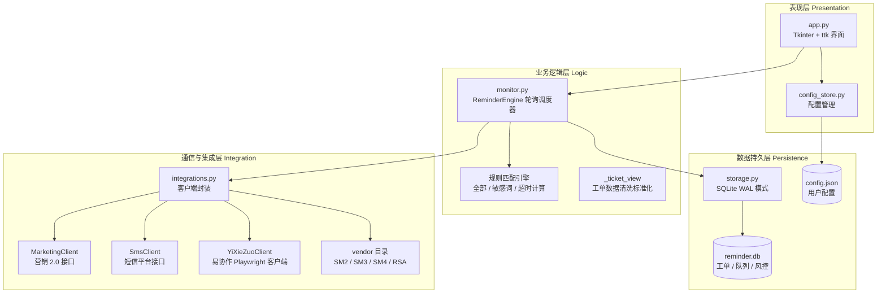
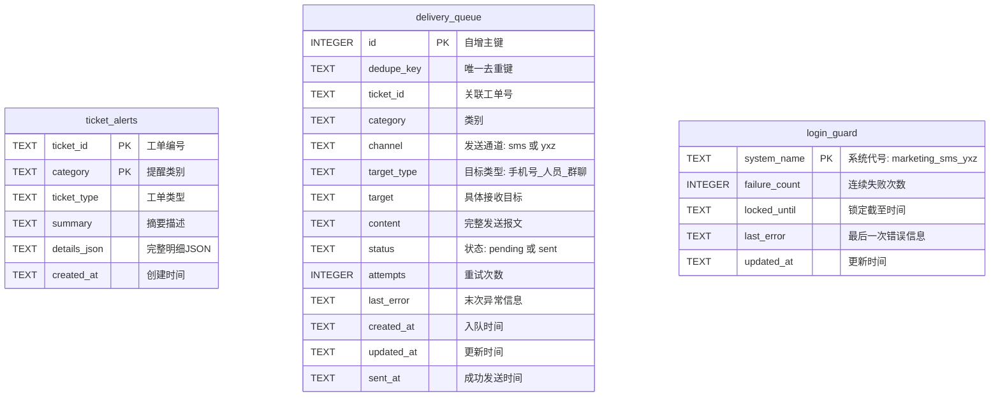
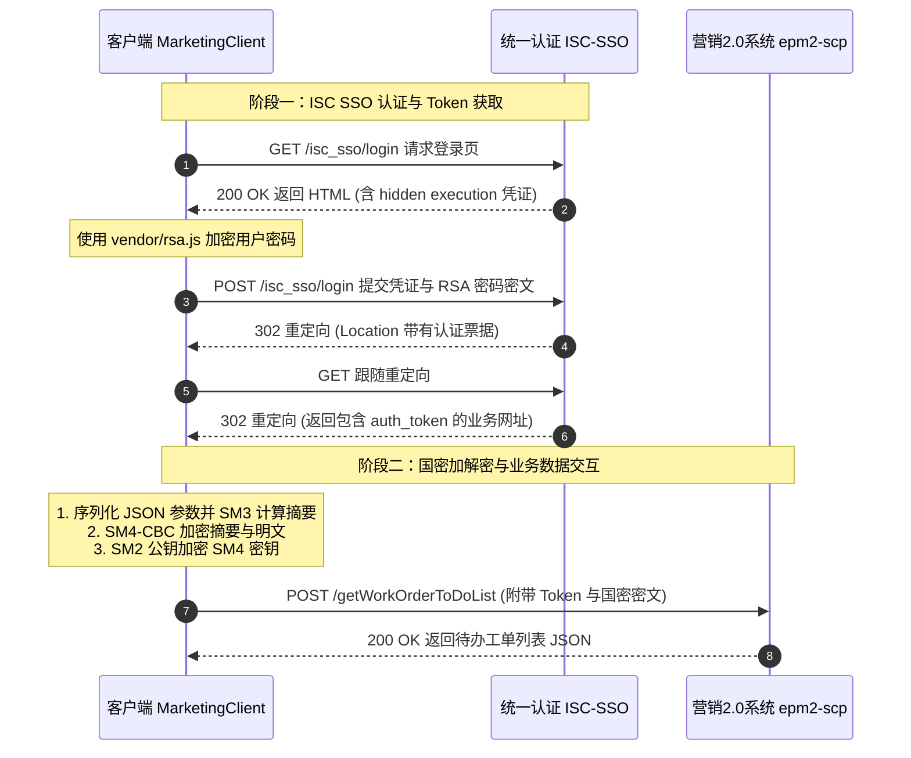
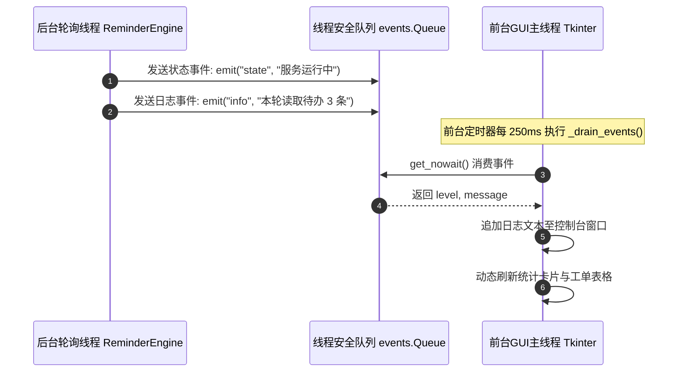

> 从 ISC SSO 统一身份认证、国密算法（SM2/SM3/SM4）双向安全通信、本地 SQLite WAL 存储与风控锁定，到三维规则调度引擎、Tkinter 线程安全事件驱动，以及 Windows 7 x64 极端无网环境离线打包全流程，提供深度的技术剖析与全模块开发指引。

<!-- more -->

---

## 📑 本文目录

1. [系统总体架构与业务全景](#1-系统总体架构与业务全景)
2. [config_store.py：配置管理与持久化模块](#2-config_storepy配置管理与持久化模块)
3. [storage.py：本地 SQLite 数据存储与风控模块](#3-storagepy本地-sqlite-数据存储与风控模块)
4. [integrations.py：外部系统集成与国密通信中枢](#4-integrationspy外部系统集成与国密通信中枢)
5. [vendor 目录：加密算法与易协作自动化底层](#5-vendor-目录加密算法与易协作自动化底层)
6. [monitor.py：监控调度与规则判定引擎](#6-monitorpy监控调度与规则判定引擎)
7. [app.py：Tkinter 图形用户界面与线程驱动](#7-apppytkinter-图形用户界面与线程驱动)
8. [build_win7.ps1 与 Spec：Win7 离线打包全流程解析](#8-build_win7ps1-与-specwin7-离线打包全流程解析)
9. [实战排错与二次开发指导](#9-实战排错与二次开发指导)

---

## 1. 系统总体架构与业务全景

### 1.1 业务背景

“95598 非故工单管控小助手”源于营销 2.0 业务场景。传统业务人员需要全天候手动刷新营销 2.0 待办工作台，极易漏看紧急诉求、客户多次反映的敏感投诉工单或临近办理红线的超时工单。

本系统定位于**纯只读的辅助管控提醒工具**：

- **安全红线**：仅调取待办工单列表与详情接口，**绝不调用**签收、派单、转派、回单等生产写接口，规避生产事故风险；
- **三维监控模型**：
  1. **全部工单**：新工单进入待办工作台立即提醒；
  2. **敏感工单**：工单内容命中预设敏感词库立即报警；
  3. **超时工单**：依据受理时间与时限配置，提前进入预警窗口时报警。
- **双通道触达**：短信系统（短信平台直发）+ 易协作（协同办公平台，支持私聊与群聊）。

### 1.2 系统架构拓扑图



---

## 2. config_store.py：配置管理与持久化模块

### 2.1 模块定位

作为系统的**集中配置管理器**，负责加载、校验、合并与持久化用户配置，隔离底层文件 IO 与业务逻辑。

### 2.2 核心设计与技术点

1. **可执行文件运行目录自适应**：
   通过判定 `sys.frozen` 状态识别当前运行于源码调试态还是 PyInstaller 单文件/单目录打包态：
   ```python
   BASE_DIR = Path(sys.executable).resolve().parent if getattr(sys, "frozen", False) else Path(__file__).resolve().parent
   ```
2. **两级配置合并机制（Default Fallback）**：
   系统维护一套硬编码的完整 `DEFAULT_CONFIG` 模板。当本地 `config.json` 缺少某项键值时（如低版本配置文件升级），通过深度递归合并策略保留默认缺省值，防止发生 `KeyError` 异常；
3. **敏感信息内存隔离与日志安全**：
   对外输出配置时提供 `mask_sensitive=True` 选项，将营销系统与短信平台的密码自动脱敏为 `******`，防止明文配置在日志或错误弹窗中外泄；
4. **配置项完整性校验**：
   在保存前对轮询周期（`poll_interval_seconds >= 10`）、超时阈值（`remind_before_hours >= 0.5`）进行范围约束校验。

---

## 3. storage.py：本地 SQLite 数据存储与风控模块

### 3.1 模块定位

基于本地轻量级 **SQLite** 数据库，负责核心告警记录的去重判定、待发送消息持久化队列（Message Queue）以及接口连续失败锁定的防封风控。

### 3.2 数据库 Schema 架构



#### 核心数据库表结构明细

| 数据表名称 | 核心字段说明 | 索引与约束 | 业务作用 |
| :--- | :--- | :--- | :--- |
| **`ticket_alerts`** | `ticket_id`, `category`, `ticket_type`, `summary`, `details_json`, `created_at` | 联合主键 `(ticket_id, category)` | 记录某张工单在特定规则下是否已生成过提醒，防止同一张工单被多次重复认领。 |
| **`delivery_queue`** | `id`, `dedupe_key`, `ticket_id`, `category`, `channel`, `target_type`, `target`, `content`, `status`, `attempts`, `last_error`, `created_at`, `updated_at`, `sent_at` | 唯一约束 `dedupe_key UNIQUE`<br/>状态索引 `idx_status` | 异步投递消息队列。任何待发通知必须先持久化入队，由后台投递线程消费，保证消息不丢不重。 |
| **`login_guard`** | `system_name`, `failure_count`, `locked_until`, `last_error`, `updated_at` | 主键 `system_name` | 账号保护计数器。一旦某系统连续认证失败达阈值，自动触发熔断冷却，防止内网账号被锁定。 |

### 3.3 关键机制解析

1. **SQLite WAL 并发模式与 Busy Timeout**：
   为了应对 GUI 界面展示与后台轮询线程同时读写本地数据库，初始化时强制开启预写日志（WAL）模式，并将锁超时时间设置为 30 秒，彻底杜绝 `database is locked` 异常：
   ```python
   connection.execute("PRAGMA journal_mode=WAL")
   connection.execute("PRAGMA busy_timeout=30000")
   ```
2. **精细化去重键（Dedupe Key）算法**：
   为避免跨模块重复发送，入队前由以下维度通过分隔符连接生成全局唯一哈希键：
   ```text
   dedupe_key = ticket_id | category | channel | target_type | target
   ```
   依赖数据库底层的 `INSERT OR IGNORE` 语法实现天然原子级幂等。
3. **接口风控熔断机制（Login Guard）**：
   针对营销系统账号在内网连续输错 3 次自动锁定的安全策略，系统设计了熔断保护机制：
   - 当 `failure_count >= max_failures`（默认 3 次）时，设置 `locked_until = now + lock_minutes`（默认冷却 30 分钟）；
   - 在冷却期未过前，跳过该接口请求，避免被动封禁生产账号。

---

## 4. integrations.py：外部系统集成与国密通信中枢

### 4.1 模块定位

负责与电网内网 3 套独立系统进行网络通信、身份认证、协议编解码及数据提取。

### 4.2 营销 2.0 系统端到端国密安全通信

营销 2.0 前后端交互全面采用了我国国家商用密码标准体系（SM2、SM3、SM4）：



#### 国密加密实现函数 `encrypt_payload` 解析

```python
def encrypt_payload(params: dict[str, Any]) -> dict[str, str]:
    from vendor import sm2, sm3, sm4
    public_key = ""
    private_key = ""
    sm4_key = ""
    
    text = json.dumps(params, ensure_ascii=False, separators=(",", ":"))
    digest = sm3.main(text)                                             # 1. SM3 计算完整性校验摘要
    encrypted = sm4.SM4().encrypt(sm4_key, digest + text)              # 2. SM4-CBC 加密 (摘要 + 明文)
    encrypted_key = sm2.SM2(private_key, public_key).encrypt(sm4_key)  # 3. SM2 公钥加密对称密钥
    return {"privateParam": encrypted_key, "data": encrypted}
```

### 4.3 核心业务接口对照表

| 接口名称 | 请求方式与 URL | 核心报文参数 | 业务说明 |
| :--- | :--- | :--- | :--- |
| **待办工单查询** | `POST /emss-cmnf-common-front/member/workOrderQuery/getWorkOrderToDoList` | `pageNo`, `pageSize: 100`, `wkOrderType: "00"`, `excludeType: "00"` | 分页拉取该营销账号名下所有待办记录，自动循环翻页直至拉全。 |
| **通用工单详情** | `GET /emss-cssrvf-cstservicesrv-front/member/csWkOrder/queryWkOrder` | `signParams: encrypt_payload({"appNo": ticket_id})` | 获取标准客户服务工单详情（户号、户名、诉求、地址、联系方式）。 |
| **催办工单详情** | `GET /emss-cssrvf-cstservicesrv-front/member/csOverseeWholeWkOrder/queryOverseeWholeWkOrder` | `signParams`, Header 注入 `businessEnv` | 专用于“客户电力服务催办”工单，解析提取关联主单号 `sufUrgeWkOrderNo`。 |
| **营配校核详情** | `GET /emss-cssrvf-cstservicesrv-front/member/AcptAsgnController/infoAbnorChkInit` | `signParams` | 专用于“信息校核异常”工单，提取其嵌套子对象 `csInfoChkVO` 与 `elecConsCustVO`。 |
| **短信平台发送** | `POST http://smsapp.zj.sgcc.com.cn/ums-webapi/msg/sendMsg` | `recvId: [{bussId: phone}]`, `content`, `appId: "5555"`, `identity: "P"` | 批量下发工单短信通知，返回 `code == 0` 代表进入运营商下发流程。 |

---

## 5. vendor 目录：加密算法与易协作自动化底层

### 5.1 文件构成及作用

- **`rsa.js`**：由营销系统前端提取的 RSA 加密库，包含标准公钥模数计算。在 Python 中通过 `py_mini_racer.MiniRacer()` 虚拟机加载并执行 `getEncryptPwd(password)`；
- **`sm2.py` / `sm3.py` / `sm4.py`**：基于纯 Python 实现的国密标准算法包，提供 SM3 杂凑算法、SM4-CBC 分组密码以及 SM2 椭圆曲线加密；
- **`yxz_sender.py`**：基于 Playwright 的易协作桌面网页端驱动模块：
  - 加载 Chromium 浏览器并保持用户持久化会话目录（`.yxz_sender_profile`）；
  - 自动寻找全局搜索框、定位接收人面板、注入富文本消息框并点击“发送”按钮；
  - 针对群聊发送支持屏蔽艾特（不 @ 全员）。

---

## 6. monitor.py：监控调度与规则判定引擎

### 6.1 模块定位

系统的调度核心大脑，负责协调定时轮询周期、工单字段标准化、三维告警规则判定以及多通道异步投递。

### 6.2 工单字段标准化模型（`_ticket_view`）

不同工单类型（常规、催办、校核）返回的 JSON 键名存在差异，`_ticket_view` 通过优先级回退映射为统一定义：

```python
# 标准化工单视图字段映射定义
StandardTicket = {
    "ticket_id": str,          # 内部工单编号 (wkOrderNo / appNo)
    "grid_ticket_id": str,     # 编号 (cscAppNo / sufUrgeCscAppNo)
    "ticket_type": str,        # 类型名称 (wkOrderName / busTypeName)
    "business_type": str,      # 业务大类
    "business_subtype": str,   # 细分类别
    "content": str,            # 受理诉求内容 (acptCont / overseeCont / chkReason)
    "customer_name": str,      # 客户名称 (custName)
    "customer_no": str,        # 客户户号 (custNo)
    "contact": str,            # 联系人姓名
    "contact_phone": str,      # 联系电话
    "address": str,            # 用电地址 / 发生地址
    "accepted_at": datetime,   # 受理时间
    "deadline_text": str,      # 办结时限
    "related_ticket_id": str,  # 关联主单编号 (仅催办单存在)
    "step": str                # 当前所在流程环节 (stepName)
}
```

### 6.3 三大告警评估逻辑（`_evaluate`）

```python
# 1. 全部工单规则：待办中首次出现即通知
if rule_all.get("enabled"):
    message = _full_message(ticket, "新待办", deadline_text)
    self._claim(ticket, "all", "全部工单", message, rule_all)

# 2. 敏感词规则：在工单内容与类型中扫描预设关键词
keywords = sensitive.get("keywords") or []
haystack = f"{ticket.get('content', '')}\n{ticket_type}"
matches = [word for word in keywords if word.casefold() in haystack.casefold()]
if sensitive.get("enabled") and matches:
    message = _full_message(ticket, "敏感内容", deadline_text, [("命中敏感词", "、".join(matches))])
    self._claim(ticket, "sensitive", "敏感字眼工单", message, sensitive, {"keywords": matches})

# 3. 超时规则：按时限阈值计算剩余时长
limit = overtime.get("type_limits", {}).get(ticket_type, overtime.get("default_limit_hours", 24))
elapsed = (datetime.now() - accepted_at).total_seconds() / 3600
remaining = limit - elapsed
if overtime.get("enabled") and remaining <= overtime.get("remind_before_hours", 2):
    status = f"已超时 {abs(remaining):.1f} 小时" if remaining < 0 else f"距超时约 {remaining:.1f} 小时"
    message = _full_message(ticket, "即将超时", deadline_text, [("配置办理时限", f"{limit:g} 小时"), ("时限状态", status)])
    self._claim(ticket, "overtime", "即将超时工单", message, overtime)
```

### 6.4 标准短信/易协作消息模板格式

```text
【**电力】工单编号:33401202610140001
工单编号：20261014955980001
受理时间:2026-10-14 08:30:00
业务类型：客户电力服务投诉,分类:供电服务质量
受理内容:用户反映多次停电，态度恶劣，要求尽快安排人员上门解决。
用户名称：张三
用户编号:3300000001
联系人：张三
联系电话：13800138000
联系地址：浙江省XX市XX路XX号
办结时限:2026-10-14 12:30:00
提醒类型:敏感字眼工单
命中敏感词：多次停电、态度恶劣
```

---

## 7. app.py：Tkinter 图形用户界面与线程驱动

### 7.1 模块定位

基于 Python 内置 Tkinter/ttk 开发的桌面 GUI 界面，兼顾 Win7 经典界面与 Win10/Win11 渲染，包含多选项卡管理、运行仪表盘、日志流展示与数据交互。

### 7.2 线程安全事件驱动模型

后台服务 `ReminderEngine` 在独立的守护线程（Daemon Thread）中循环运行，**绝不允许直接操作 UI 组件**（会导致 Tkinter 发生崩溃或无响应）。
本项目通过线程安全的 FIFO 事件队列解耦：



### 7.3 主要选项卡职责划分

| 选项卡 | 核心组件与功能 |
| :--- | :--- |
| **运行控制台** | 服务启停大按钮、轮询倒计时进度条、当日告警数与待办总数统计卡片、实时滚动富文本日志流窗口。 |
| **基础配置** | 营销 2.0 用户名/密码输入、短信网关地址与 AppID、易协作接收人/群聊名称。 |
| **规则设定** | 全部工单开关、敏感词标签式增删面板、分类超时时限矩阵表。 |
| **历史告警** | 树状表格（Treeview）查看已识别的预警工单，支持快捷复制工单号与详情弹窗。 |

---

## 8. build_win7.ps1 与 Spec：Win7 离线打包全流程解析

### 8.1 打包挑战与特殊约束

基层供电所办公环境复杂，存在大量 **Windows 7 64 位 SP1 专业版/旗舰版操作系统**，且内网终端处于物理隔离或严格受限的无网状态：

- **挑战 1**：Python 3.9+ 官方已不再支持 Windows 7；
- **挑战 2**：内网环境缺乏通用 C 运行时库（Universal C Runtime, UCRT）与 Visual C++ 2015-2022 Redistributable，易出现 `api-ms-win-crt-runtime-l1-1-0.dll is missing` 弹窗；
- **挑战 3**：Playwright 默认会下载最新版本 Chromium，而现代 Chromium 内核早已停止对 Win7 的支持。

### 8.2 关键打包技术方案

1. **基准运行环境固定**：
   统一锁定在可在 Windows 7 上稳定运行的最高官方版本 **Python 3.8.10 x64** 独立虚拟环境；
2. **UCRT 与 VC 运行库静态注入**：
   在打包脚本 `build_win7.ps1` 中，显式将目标系统必需的底层依赖全量复制注入至打包输出目录根部：
   - Universal C Runtime (`api-ms-win-*.dll` 共约 40 个支持库)；
   - Microsoft Visual C++ 核心动态链接库 (`vcruntime140.dll`、`vcruntime140_1.dll`、`msvcp140.dll`、`msvcp140_1.dll`)。
3. **PE 二进制机器码强校验**：
   ```python
   def compatible(entry):
       name, source, kind = entry
       ...
       machine = pefile.PE(source, fast_load=True).FILE_HEADER.Machine
       if machine != 0x8664: # 强校验 x64 架构
           return False
   ```
   借助 `pefile` 分析所有打包进来的 `.dll` 和 `.pyd`，直接剔除任何残留的 32 位二进制，杜绝 `Bad Image / 0xc000007b` 报错；
4. **MiniRacer 与离线 Chromium 打包**：
   - MiniRacer 的 `mini_racer.dll` 被强制绑定至打包根目录；
   - 内置 Win7 兼容的 Chromium 96 浏览器内核放置于 `playwright/driver/package/.local-browsers`，确保无网环境下易协作浏览器组件即开即用。

---

## 9. 实战排错与二次开发指导

### 9.1 常见运维故障与排查路线

1. **营销 2.0 登录失败提示“账号或密码错误” / 触发风控锁定**：
   - 检查内网账号是否已被在其他终端连续输错锁定，确认是否处于 `login_guard` 冷却期；
   - 确认 `vendor/rsa.js` 执行是否正常，检查 `MiniRacer` 运行时是否缺失底层依赖。
2. **易协作消息发送超时或失败**：
   - 检查当前用户是否有权向目标群聊发送消息；
   - 确认 `.yxz_sender_profile` 会话是否过期，若过期需在弹出的浏览器中重新扫码或登录一次。
3. **数据库出现 `database is locked`**：
   - 确保外部没有第三方 SQLite 查看工具以独占方式打开了 `reminder.db`。

### 9.2 二次开发与代码扩展建议

1. **新增待办工单过滤维度**：
   在 `_ticket_view` 中已清洗提取了 `address`（用电地址）与 `customer_no`（用户户号），可在 `monitor.py` 的 `_evaluate` 中扩展“重点保供电线路”、“大客户专线”、“重复报修黑名单”等自定义匹配规则；
2. **新增提醒通道（如企业微信、钉钉机器人、飞书 Webhook）**：
   - 在 `integrations.py` 中新增对应的客户端类；
   - 在 `config_store.py` 的配置模板中追加 Webhook URL 配置；
   - 在 `storage.py` 中直接复用 `delivery_queue` 队列，系统会自动按通道类型轮询消费并异步下发。
