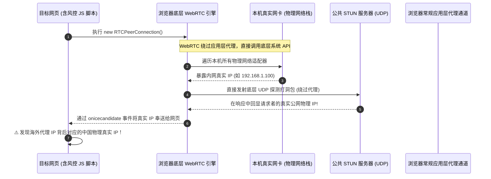

明明开启了代理节点，IP 查询网站也显示在海外，为什么访问 ChatGPT、Netflix、PayPal 或者做海外业务、爬虫采集时，照样被对方的风控系统瞬间识别甚至封禁？

经过深入排查才会发现：**代理工具往往只帮你更换了常规 HTTP/TCP 的出口 IP，但操作系统的网络协议栈和浏览器底层隐藏着两个致命的“旁路通道”，会绕过代理，直接把你真实的物理公网 IP 和国内运营商归属地出卖给目标网站！**

这两个致命漏洞就是：**DNS 泄漏** 与 **WebRTC 泄漏**。

本文分为两大部分：前半部分提供**保姆级实操排查与修复步骤**（含系统网卡配置、组策略/注册表及浏览器插件设置），后半部分深入**硬核科普 DNS 泄漏、DoH（DNS over HTTPS）以及 WebRTC 的底层运行机制**，让你彻底弄懂原理并构建无死角的网络隐私防线。

<!-- more -->

---

# 排查与泄漏修复指南

想要实现 100% 纯净且防泄漏的代理环境，建议按照以下步骤逐一排查并配置：

## 一、关闭物理网卡的 IPv6 协议（最易忽视的死角）

这是绝大多数人踩坑的第一处盲区。目前国内绝大部分家庭宽带、光纤和移动热点均已默认开启并分配了公网 IPv6 地址。而市面上绝大部分代理节点和代理协议默认只代理 IPv4 流量。

当目标网站支持双栈解析（IPv4 + IPv6）时，Windows 系统会优先发起 IPv6 连接。由于代理客户端没有接管 IPv6，系统就会直接通过物理网卡直连目标服务器——**结果就是你挂着代理，对方却直接拿到了你国内宽带分配的真实 IPv6 地址！**

### 操作步骤：
1. 打开 `控制面板` → `网络和 Internet` → `网络连接`；
2. 找到当前正在上网的网卡（以太网或 WLAN），右击选择 **属性**；
3. 在网络属性列表中，取消勾选 **Internet 协议版本 6 (TCP/IPv6)**；
4. 点击 **确定** 保存退出。


---

## 二、解决 Windows 智能多宿主名称解析（DNS 泄漏源头）

Windows 系统中内置了一项名为 **智能多宿主名称解析（Smart Multi-Homed Name Resolution）** 的加速机制。其原本初衷是为了提升解析速度：当系统检测到有多个网络适配器（例如真实物理网卡 + 代理/VPN 的虚拟 TAP/TUN 网卡）时，它会**向所有适配器同时并发发送 DNS 查询请求**，并采纳最先返回的那个结果。

这就导致了一个严重后果：你的真实物理网卡也在向国内运营商（电信/联通/移动）的本地 DNS 发送查询请求，海外目标网站通过特定的探测机制即可发现你解析使用的 DNS 来自国内，从而判定你处于代理伪装状态。

以下两种关闭方法任选其一即可：

### 方法 1：通过本地组策略编辑器关闭（推荐 Windows 专业版/企业版）
1. 按下快捷键 `Win + R`，输入 `gpedit.msc` 回车打开组策略编辑器；
2. 依次展开定位到：
   `计算机配置` → `管理模板` → `网络` → `DNS 客户端`；
3. 在右侧列表中找到 **关闭智能多宿主名称解析**（或“禁用智能多宿主解析”）；
4. 双击打开，将其状态勾选为 **已启用（Enabled）**，点击确定。


### 方法 2：修改注册表（全版本通用，适合 Windows 家庭版）
1. 按下快捷键 `Win + R`，输入 `regedit` 回车打开注册表编辑器；
2. 在顶部地址栏快速定位到以下路径：
   ```text
   HKEY_LOCAL_MACHINE\SOFTWARE\Policies\Microsoft\Windows NT\DNSClient
   ```
   *(注：如果路径下缺少 `DNSClient` 项，直接在上一级右键选择“新建”→“项”，命名为 `DNSClient` 即可)*；
3. 进入 `DNSClient` 项后，在右侧空白区域单击右键 → **新建** → **DWORD (32 位)值**；
4. 将值名称命名为：`DisableSmartNameResolution`；
5. 双击该值，将 **数值数据** 修改为 `1`（基数选择十六进制或十进制皆可），点击确定。


> **重要提示**：无论通过组策略还是注册表修改，操作完成后必须**重启一次计算机**方可完全生效。

---

## 三、彻底禁用浏览器的 WebRTC 协议

WebRTC 是浏览器的底层通信协议，由于它通过操作系统底层直接发送 UDP 穿透探测包，**常规的应用层浏览器代理（如 HTTP/Socks5 代理插件）根本无法拦截 WebRTC**。目标网站只需在网页中植入几行 JavaScript 脚本，就能轻易穿透代理直接读取你的真实内网及公网 IP。

### 解决方案：使用浏览器扩展彻底禁用 WebRTC
以主流的 Google Chrome / Edge 等 Chromium 内核浏览器为例：

1. 进入 Chrome 应用商店，搜索插件：**WebRTC Control**；
2. 认准插件图标与名称直接安装：


3. 安装后确保插件处于启用状态（插件图标变为蓝色即代表已全面屏蔽 WebRTC 物理接口探测）。

> **补充说明（Firefox 火狐浏览器原生关闭方式）**：  
> Firefox 用户无需安装插件，直接在地址栏输入 `about:config`，搜索 `media.peerconnection.enabled`，双击将其由 `true` 切换为 `false` 即可彻底关闭 WebRTC。

---

## 四、检查并关闭代理客户端内的 IPv6 设置

除了物理网卡需要关闭 IPv6 协议外，还需检查你使用的代理客户端（如 Clash、V2Ray、Clash Verge、Mihomo 等）自身的路由配置。确保客户端没有放行或直连本地 IPv6 流量：


将代理软件中的 **IPv6** 开关置为关闭状态，强制所有流量均走 IPv4 隧道分流。

---

## 五、最终验证与全方位防泄漏检测

全部设置完毕并重启电脑后，我们需要验证伪装环境是否真正无懈可击。

1. 打开权威网络泄露检测站点：[https://ipleak.net](https://ipleak.net/)；
2. 观察检测结果的关键三要素：
   - **Your IP Address（公网 IP）**：只显示你的海外代理节点 IP，且 IPv6 处应显示 `No IPv6 address detected`（未检测到 IPv6）。
   - **WebRTC Detection（WebRTC 探测）**：应显示 `No leak, WebRTC is disabled or blocked`（无泄露或已禁用），绝不能出现国内物理 IP。
   - **DNS Addresses（DNS 服务器列表）**：列表中列出的所有 DNS 服务器**必须全部位于海外节点所在地**，绝不能出现中国大陆运营商（如 China Telecom / China Unicom / China Mobile）的服务器！


如果上述三项均完全符合，说明你的网络环境已经彻底消除了 DNS 和 WebRTC 泄漏风险！

---

# 搞懂原理不再踩坑

很多人在排查设置时只知其然不知其所以然。下面我们系统梳理与网络防封、防风控息息相关的几个关键核心常识。

## 一、什么是 DNS 泄漏？风控网站是如何察觉的？

### 1. 传统 DNS 解析机制
DNS（域名系统）是互联网的“电话簿”，负责将人类可读的域名（如 `google.com`）翻译成计算机识别的 IP 地址（如 `172.217.160.142`）。

传统的 DNS 请求默认走的是 **UDP 端口 53**，**且全部以明文形式明晃晃地在网络中裸奔**。当你在浏览器输入网址时：
- 默认情况下，请求会发往你本地路由器或者国内运营商（ISP）的递归 DNS 服务器；
- 运营商不仅能一清二楚地记录你访问过的每一个网站域名，还能根据政策要求对结果进行劫持篡改（即常见的 DNS 投毒与污染）。

### 2. 为什么开启代理后依然会发生 DNS 泄漏？
很多普通代理工具（特别是仅配置了系统 HTTP/Socks5 代理时）只负责接管建立连接后的 TCP 数据流。在建立连接前，**“把域名解析成 IP”这个动作如果发生在你本机的操作系统上**，就会出现以下漏洞：

```mermaid
flowchart TD
  subgraph 泄露情况[❌ DNS 发生泄漏]
    A1[浏览器访问敏感网站] -->|本地发起 UDP 53 明文查询| B1[国内运营商 Local DNS]
    B1 -->|暴露用户真实 IP 与访问域名| C1[DNS 解析结果返回]
    C1 -->|通过代理发起 TCP 连接| D1[目标网站]
    D1 -.->|探测检测到中国 ISP 的解析记录| E1[⚠️ 判定代理伪装，触发风控拦截]
  end

  subgraph 安全情况[✅ 远端安全防泄漏]
    A2[浏览器访问敏感网站] -->|Fake-IP 或域名直接打包| B2[代理加密隧道]
    B2 -->|远端服务器发起安全查询| C2[海外干净 DNS / 节点直解]
    C2 -->|远端建立连接返回数据| D2[目标网站]
    D2 -.->|只看到海外安全 DNS| E2[🟢 安全通过，无泄漏]
  end
```



### 3. 目标网站（如 ipleak.net、风控系统）是如何检测出你的真实 DNS 的？
检测网站并不是去黑你的电脑，而是利用了 DNS 权威解析原理：
1. 检测页面会用 JavaScript 动态生成一个全球唯一的专属随机子域名，例如：`random-uuid-987654.ipleak.net`；
2. 由于这个子域名从不存在，全世界没有任何缓存，你的电脑必须逐级向上查询；
3. 如果发生泄漏，你的电脑会找中国电信/联通的 Local DNS，最终中国电信的服务器就会代表你向 `ipleak.net` 的官方权威 DNS 发起查询；
4. `ipleak.net` 的服务器一看：“刚才询问 `random-uuid-987654` 这个专属于你的唯一子域名的，居然是一个来自中国上海电信的 DNS 服务器 IP！”——至此，你的真实地理位置与网络身份瞬间暴露无遗。

---

## 二、深度解析：DoH（DNS over HTTPS）到底是什么？

### 1. 什么是 DoH？
**DoH（DNS over HTTPS）** 是由 IETF 于 2018 年标准化的安全传输协议（RFC 8484）。它将原本走明文 UDP 53 端口的 DNS 查询与响应，**直接打包伪装在标准的 HTTPS 协议（TCP 443 端口）中进行传输**。

### 2. DNS 协议对比总览

| 协议类型 | 底层协议 | 默认端口 | 传输加密 | 防 ISP 嗅探与劫持 | 混淆伪装能力 |
| :--- | :--- | :--- | :--- | :--- | :--- |
| **传统 DNS** | UDP / TCP | 53 | ❌ 明文 | ❌ 极易被嗅探/篡改/污染 | ❌ 无任何伪装 |
| **DoT (DNS over TLS)** | TCP (TLS) | 853 | ✅ 强加密 | ✅ 可防窥探与篡改 | ⚠️ 专属 853 端口，极易被防火墙特征识别并直接切断 |
| **DoH (DNS over HTTPS)** | TCP/QUIC (TLS) | 443 | ✅ 强加密 | ✅ 完全杜绝运营商日志审计与投毒 | 🟢 完美混入正常网站的 443 HTTPS 流量中，无法被单独识别与封锁 |

### 3. 避坑警示：在代理环境下滥用 DoH 可能会“反向翻车”！
很多人误以为“只要在 Chrome 或 Edge 设置里开启 DoH（安全 DNS），就一定能防止泄露”，这种认知是非常危险的：

> 🚨 **典型翻车案例**：  
> 某同学为了“安全”，在 Chrome 浏览器设置里开启了安全 DNS，并填入了阿里（`dns.alidns.com`）或腾讯（`doh.pub`）的公共 DoH 地址。  
> 此时，浏览器解析所有境外网站域名的请求，都会通过加密 HTTPS 直连国内阿里/腾讯的服务器。其直接后果是：
> 1. 国内公共 DNS 依然记录了你的完整访问域名清单；
> 2. 海外 CDN 网站会因为解析自国内 DNS，给你返回国内接入点 IP 或解析异常；
> 3. 目标风控系统探测到的依然是国内解析特征，反而破坏了代理客户端原本的分流策略！

**最佳实践**：
- 如果你使用的是 Clash / Mihomo / Surge 等具备完整内核接管能力的高级代理工具，建议**在浏览器内关闭独立安全 DNS**，让域名解析全权交由代理核心的 TUN / Fake-IP 模式处理；
- 代理客户端内部的上游 DNS 列表中，国内直连域名可使用国内公共 DoH，而海外分流规则中必须指定纯正的远端海外安全 DoH（如 Cloudflare `https://1.1.1.1/dns-query`、Google `https://8.8.8.8/dns-query`）。

---

## 三、深度解析：WebRTC 为什么能“肉身翻墙，网线穿墙”？

### 1. 什么是 WebRTC？
**WebRTC（网页实时通信，Web Real-Time Communication）** 是一项由 Google 推动并被 W3C 标准化的技术。它允许现代浏览器在不需要安装任何第三方插件或客户端的情况下，直接进行点对点（P2P）的超低延迟音视频通话、屏幕共享和文件互传（如 Google Meet、Discord 网页版等）。

### 2. 为什么 WebRTC 会穿透浏览器代理？
这由 WebRTC 的底层连通性协议决定。为了让两个位于不同复杂 NAT（路由器、防火墙）背后的设备建立最高效的直连通道，WebRTC 采用了 **ICE（交互式连接建立）** 与 **STUN（NAT 会话周游实用工具）** 机制：



通过上述时序图可以看出：
- 浏览器的普通代理插件（如各类 Switchy 插件、系统代理设置）只工作在**应用层**；
- 而 WebRTC 的 STUN 探测请求是在浏览器原生 C++ 底层直接向操作系统网络协议栈申请直发 UDP 包；
- 目标网页只需要调用几行最基础的 JS 代码监听 `icecandidate` 事件，就能在 **0.1 秒内** 绕过一切应用层代理，将你的局域网私有 IP 以及路由器分配的真实公网 IP 扒得一干二净！
- 这也是为什么在防封、防爬虫风控领域，**彻底禁用 WebRTC（或全局 TUN 模式接管所有 UDP 流量）** 是不可逾越的红线。

---

## 四、网络指纹与反风控防范建议（延伸认知）

IP 和 DNS 干净了，是不是就万事大吉了？对于高安全级别的风控系统（如 Cloudflare 5秒盾、Akamai、DataDome、OpenAI 等），IP 防护只是最基础的第一关。要想做到万无一失，还需注意以下维度：

1. **时区、语言与 IP 的逻辑一致性**：
   如果你的 IP 显示在美国洛杉矶（UTC-7/UTC-8），但操作系统时区是 `GMT+8 (北京时间)`、浏览器首选语言是 `zh-CN`、输入法是中文输入法，这种巨大的矛盾感在风控引擎眼里属于典型的高风险特征。
2. **浏览器高级指纹（Browser Fingerprinting）**：
   - **Canvas 指纹 / WebGL 指纹**：利用不同显卡和图形驱动渲染微小图像的像素差异计算出唯一的设备 Hash；
   - **AudioContext 指纹**：通过音频硬件合成信号差异标识设备；
   - **字体指纹**：检测操作系统安装的中英文字体列表。
3. **TLS 握手特征（JA3 / JA4 指纹）**：
   不同浏览器（Chrome、Firefox、Safari、Python Requests、Curl）在发起 TLS 握手时的 Client Hello 报文特征（密码套件排序、扩展列表）完全不同，普通的爬虫或脚本极易在此处暴露身份。

---

## 总结

网络隐私与多账号安全是一场持续对抗的系统工程。总结起来，基础防泄漏必做的“四部曲”是：
1. **关物理 IPv6**（杜绝无代理通道的双栈裸奔）；
2. **禁多宿主名称解析**（切断 Windows 默认的本地运营商 DNS 偷跑）；
3. **关 WebRTC**（利用插件或配置锁死浏览器的底层 STUN 穿透通道）；
4. **权威站点复检**（养成在 `ipleak.net` 或 `browserleaks.com` 验证的良好习惯）。

希望本文不仅能帮你彻底解决代理环境下的泄露问题，更能让你对底层的网络安全与传输机制有更加清晰通透的理解！
