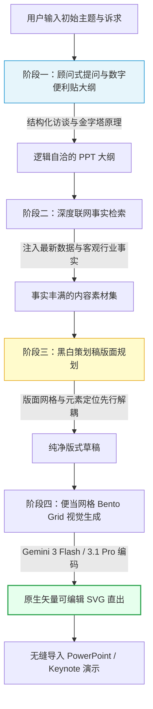

> 本文整理自国内一线顶级演示设计专家（7 年商业演示实战 + 3 年 AI 产品落地）的深度实战复盘。市面上 99% 的“一键生成 AI PPT”工具为什么让人感到“粗制滥造、无法商用”？本文深入剖析商业级 PPT Agent 的核心技术路径，揭秘从**顾问式需求调研、数字便利贴大纲、深度联网事实检索、专业策划稿版面规划**，到**便当网格（Bento Grid）与原生矢量 SVG 直出**的完整工业级流水线，并公开团队在生产环境中验证有效的核心提示词（Prompt）。

<!-- more -->

---

## 📑 本文目录

- [一、行业反思：市面上的 AI PPT 工具到底错在哪？](#一、行业反思：市面上的-AI-PPT-工具到底错在哪？)
- [二、架构全览：专业级 PPT Agent 的四阶段流水线](#二、架构全览：专业级-PPT-Agent-的四阶段流水线)
- [三、阶段一：忘了“一键生成”，像专业顾问一样提问](#三、阶段一：忘了“一键生成”，像专业顾问一样提问)
  - [3.1 需求调研与追问机制](#3-1-需求调研与追问机制)
  - [3.2 结构化组织：数字便利贴法](#3-2-结构化组织：数字便利贴法)
  - [3.3 生产级 Prompt：顶级 PPT 结构架构师（Context-Aware v2.0）](#3-3-生产级-Prompt：顶级-PPT-结构架构师（Context-Aware-v2-0）)
- [四、阶段二：用真实数据填充血肉——深度事实检索](#四、阶段二：用真实数据填充血肉——深度事实检索)
  - [4.1 为什么大纲之后不能直接写正文？](#4-1-为什么大纲之后不能直接写正文？)
  - [4.2 检索工具协同与事实注入技巧](#4-2-检索工具协同与事实注入技巧)
- [五、阶段三：万元每页 PPT 公司的秘密——“策划稿”机制](#五、阶段三：万元每页-PPT-公司的秘密——“策划稿”机制)
  - [5.1 揭秘顶级演示设计公司的核心岗位：“策划师”](#5-1-揭秘顶级演示设计公司的核心岗位：“策划师”)
  - [5.2 为什么将“版面规划”与“视觉设计”彻底解耦？](#5-2-为什么将“版面规划”与“视觉设计”彻底解耦？)
  - [5.3 从骨架草稿到视觉精雕的实测效果](#5-3-从骨架草稿到视觉精雕的实测效果)
- [六、阶段四：设计语言革命——便当网格（Bento Grid）与原生矢量 SVG 直出](#六、阶段四：设计语言革命——便当网格（Bento-Grid）与原生矢量-SVG-直出)
  - [6.1 苹果发布会的设计密码：为什么选择便当网格？](#6-1-苹果发布会的设计密码：为什么选择便当网格？)
  - [6.2 生产级 Prompt：便当网格（Bento Grid）排版专家指令](#6-2-生产级-Prompt：便当网格（Bento-Grid）排版专家指令)
  - [6.3 生产级 Prompt：文字内容一键转高质量 SVG 演示页](#6-3-生产级-Prompt：文字内容一键转高质量-SVG-演示页)
  - [6.4 为什么放弃 HTML/图片，死磕难度极高的原生 SVG？](#6-4-为什么放弃-HTML-图片，死磕难度极高的原生-SVG？)
- [七、总结与未来展望：AI 做 PPT 绝不仅是套模板](#七、总结与未来展望：AI-做-PPT-绝不仅是套模板)

---

## 一、行业反思：市面上的 AI PPT 工具到底错在哪？

当前市面上绝大多数声称“一键生成 PPT”的 AI 工具，在产品逻辑上都陷入了一个致命误区：

用户刚输入一个模糊的主题（例如“新能源汽车市场分析”），系统就迫不及待地生成一份千篇一律的粗糙大纲，随后强行套用预置的模板库，把色彩艳丽但毫无逻辑的几何图形、占位图标怼到用户眼前。

**但演示文稿的核心灵魂从来都是逻辑与内容，而非华丽的皮囊。**

回顾人类专业 PPT 专家的制作流程，从来没有任何高水平设计师是一上来就套模板画图的。核心逻辑必然是三步连环提问：
1. **为谁做？**（受众认知结构与决策心理）
2. **做什么？**（核心事实、论据与关键信息）
3. **达到什么目标？**（汇报审批、融资说服还是知识交付）

如果跳过对真实场景的调研与事实论据的收集，AI 吐出来的只会是空洞无物的车轱辘话和模板垃圾。

---

## 二、架构全览：专业级 PPT Agent 的四阶段流水线

为了解决这一行业顽疾，我们跳出“模板填字”的旧思维，将人类顶级 PPT 设计咨询公司的专家工作流解构，重塑为一套由 **4 个专精 Agent 阶段**组成的协同架构：



---

## 三、阶段一：忘了“一键生成”，像专业顾问一样提问

### 3.1 需求调研与追问机制

在第一阶段，Agent 扮演的角色不是“绘图员”，而是一位**高级管理顾问**。

当用户输入一个初始主题后，系统第一反应不是生成页面，而是自动联网对行业动态做初步的背景扫描，随后针对核心场景向用户提出 3~5 个具有启发性的关键问题，引导用户把核心受众、业务痛点与交付目标交代清楚：


只有当上下文被充分补充、真实诉求被聊透后，大模型结合检索到的背景知识，才能输出真正“有的放矢”的高质量大纲。

### 3.2 结构化组织：数字便利贴法

在大纲的交互设计上，我们借鉴了实体头脑风暴中的经典方法——**便利贴法**。

过去在策划大型商业提案时，顾问们通常会将每一页的核心论点写在实体便利贴上，整面墙排开。这样整套 PPT 的逻辑推演脉络清晰可见：论点薄弱就撕掉，前后顺序颠倒就随时替换。

在产品中，我们将每一页都设计为一个**“数字便利贴”**，支持用户在大纲阶段以极低心智成本自由调整逻辑流：


### 3.3 生产级 Prompt：顶级 PPT 结构架构师（Context-Aware v2.0）

以下为我们在生产环境中真实调优并验证有效的全套大纲架构师系统指令：

```markdown
# Role: 顶级的PPT结构架构师

## Profile
- 版本：2.0 (Context-Aware)
- 专业：PPT逻辑结构设计
- 特长：运用金字塔原理，结合背景调研信息构建清晰的演示逻辑

## Goals
基于用户提供的 PPT主题 和 背景调研信息 (Context)，设计一份逻辑严密、层次清晰的PPT大纲。

## Core Methodology: 金字塔原理
1. 结论先行：每个部分以核心观点开篇
2. 以上统下：上层观点是下层内容的总结
3. 归类分组：同一层级的内容属于同一逻辑范畴
4. 逻辑递进：内容按照某种逻辑顺序展开

## 重要：利用调研信息
你将获得一些关于主题的搜索摘要。请务必参考这些信息来规划大纲，使其切合当前的市场现状或技术事实，而不是凭空捏造。
例如：如果调研显示"某技术已过时"，则不要将其作为核心推荐。

## 输出规范
请严格按照以下JSON格式输出，结果用[PPT_OUTLINE]和[/PPT_OUTLINE]包裹：

[PPT_OUTLINE]
{
  "ppt_outline": {
    "cover": {
      "title": "引人注目的主标题",
      "sub_title": "副标题",
      "content": []
    },
    "table_of_contents": {
      "title": "目录",
      "content": ["第一部分标题", "第二部分标题", "..."]
    },
    "parts": [
      {
        "part_title": "第一部分：章节标题",
        "pages": [
          { "title": "页面标题1", "content": [] },
          { "title": "页面标题2", "content": [] }
        ]
      }
    ],
    "end_page": {
      "title": "总结与展望",
      "content": []
    }
  }
}
[/PPT_OUTLINE]

## Constraints
1. 必须严格遵循JSON格式。
2. 页数要求：{{PAGE_REQUIREMENTS}}
```

---

## 四、阶段二：用真实数据填充血肉——深度事实检索

### 4.1 为什么大纲之后不能直接写正文？

大纲只是骨架，**血肉需要真实、准确的客观信息来填充**。大模型直接生成的正文内容极易产生事实性幻觉或泛泛而谈的套话。

在工程落地上，我们对大纲规划出的每一个具体页面主题，都会触发后台检索接口，自动搜集该领域最新的行业数据、行业研报摘要与典型案例：


### 4.2 检索工具协同与事实注入技巧

如果你希望在自己的个人工作流或开发项目中复现此环节，强烈推荐使用具备极强长文事实整合能力的工具（如 **Grok** 或 **Perplexity**）：

将大纲中规划出的每一页标题逐一提供给检索模型，要求其针对该标题进行深度事实收集与数据提取，从而为后续的设计排版提供详实有力的信息基础：


---

## 五、阶段三：万元每页 PPT 公司的秘密——“策划稿”机制

### 5.1 揭秘顶级演示设计公司的核心岗位：“策划师”

国内顶尖商业 PPT 定制公司（单页报价可达 10,000+ 元）的作业模式中，有一个不可替代的核心岗位——**策划师**：


策划师不碰具体的调色、光影或排版样式，他们的产出物是一份严密的**“策划草稿”**：清晰固定每页要摆放哪些核心元素、采用何种信息层级、主次关系如何分配：


### 5.2 为什么将“版面规划”与“视觉设计”彻底解耦？

让单一 Prompt 同时负责“归纳信息 + 计算版面位置 + 设计美学色彩 + 输出代码”，模型认知负荷极高，极易顾此失彼。

在我们的 Agent 流程中，我们把两者严格解耦：
1. **策划阶段**：先让 AI 生成一份**不带花哨特效、纯净素雅的黑白版面初稿**，专注处理信息逻辑与网格空间划分；
2. **设计阶段**：在初稿框架完全确定的前提下，再挂接视觉设计 Prompt 注入设计美学、品牌配色与矢量质感。

经过海量对比测试证明：这种仿照人类专家流水线的分段设计，输出稳定性呈数量级提升。

### 5.3 从骨架草稿到视觉精雕的实测效果

初稿仅保留元素对齐与空间比例，逻辑一目了然：


在此基础上注入视觉设计，即可得到商业演示级别的精美成品：


---

## 六、阶段四：设计语言革命——便当网格（Bento Grid）与原生矢量 SVG 直出

### 6.1 苹果发布会的设计密码：为什么选择便当网格？

在版式设计上，我们全面拥抱了以 Apple 为代表的高级设计语言——**便当网格（Bento Grid / 卡片式布局）**：


例如在处理信息密度极高的上市公司年度财报（如 300 多页的财务公告）时，卡片式布局展现出了无与伦比的优势：


通过合理的便当网格重构，不仅信息容纳量大，视觉层级更是一目了然：


**便当网格的三大核心优势**：
1. **信息承载力极强**：单页内可同时清晰容纳 4~6 个维度的数据与图表；
2. **排版灵活性极高**：卡片数量、宽高与对齐比例自由组合，版式永不重样；
3. **大模型最容易理解的设计语言**：卡片具有明确的几何边界，大模型在计算坐标、间距与文字换行时极少翻车。

### 6.2 生产级 Prompt：便当网格（Bento Grid）排版专家指令

```markdown
内容页的便当网格 (Bento Grid) 布局
这是一种灵活的网格系统，其布局应由内容本身的需求驱动，而非僵硬的模板。通过组合不同尺寸的卡片，创造出动态且视觉有趣的布局。
- 核心原则:
    - 灵活性: 卡片数量不固定。可以是 1, 2, 3, 4, 5 或更多个，取决于如何更好地呈现信息。
    - 层级感: 使用卡片尺寸建立视觉层级。最重要的信息放在最大的卡片上。
    - 留白: 在所有卡片之间保持至少 20px 的间距。
- 布局组合示例:
    - 单一焦点: 一张大卡片覆盖大部分区域 (w=1200, h=580)。适用于单一、有力的信息或详细的图表。
    - 两栏布局:
        - 50/50 对称: 两张等宽的卡片。
        - 非对称: 一张较宽的卡片（如 2/3 宽度）用于主内容，一张较窄的（1/3 宽度）用于辅助信息、数据或图片。
    - 三栏布局: 三张等宽的卡片，适合并列比较三项内容。
    - 主次结合: 一张大的居中卡片，两侧各一张小的垂直卡片。
    - 顶部英雄式: 顶部一张宽幅“英雄”卡片，下方是 2-4 个较小的等宽卡片网格。
    - 混合网格 (自由度最高): 自由混合各种尺寸的卡片，例如一个中等方块、两个小的水平矩形和一个垂直矩形。这种方式可以极大地适应不同内容的需求。
```

### 6.3 生产级 Prompt：文字内容一键转高质量 SVG 演示页

将检索整理好的信息与下列提示词结合，即可调用前沿大模型完成整页矢量渲染：

```markdown
作为精通信息架构与 SVG 编码的专家，你的任务是将完整的文字内容转化为一张高质量、结构化、具备高级感、简洁感和专业感的 SVG 演示文稿页面。要求如下：

1. 画布规范: SVG viewBox 必须是 0 0 1280 720。

2. 内容页的便当网格 (Bento Grid) 布局规范:
这是一种灵活的网格系统，其布局应由内容本身的需求驱动，而非僵硬的模板。通过组合不同尺寸的卡片，创造出动态且视觉有趣的布局。
- 核心原则:
    - 灵活性: 卡片数量不固定。可以是 1, 2, 3, 4, 5 或更多个，取决于如何更好地呈现信息。
    - 层级感: 使用卡片尺寸建立视觉层级。最重要的信息放在最大的卡片上。
    - 留白: 在所有卡片之间保持至少 20px 的间距。
- 布局组合示例:
    - 单一焦点: 一张大卡片覆盖大部分区域 (w=1200, h=580)。适用于单一、有力的信息或详细的图表。
    - 两栏布局:
        - 50/50 对称: 两张等宽的卡片。
        - 非对称: 一张较宽的卡片（如 2/3 宽度）用于主内容，一张较窄的（1/3 宽度）用于辅助信息、数据或图片。
    - 三栏布局: 三张等宽的卡片，适合并列比较三项内容。
    - 主次结合: 一张大的居中卡片，两侧各一张小的垂直卡片。
    - 顶部英雄式: 顶部一张宽幅“英雄”卡片，下方是 2-4 个较小的等宽卡片网格。
    - 混合网格 (自由度最高): 自由混合各种尺寸的卡片，例如一个中等方块、两个小的水平矩形和一个垂直矩形。

请你根据我的内容输出标准完整的 SVG 代码，我的内容是：
```

在推理模型选型上，推荐使用代码生成与空间逻辑极强的 **Gemini 3 Flash**（性价比极高）或 **Gemini 3.1 Pro**：


模型将直接输出包含完整图形元素与字号对齐的矢量 SVG 代码：


### 6.4 为什么放弃 HTML/图片，死磕难度极高的原生 SVG？

市面上多数 PPT 方案选择生成 PNG 截图或网页 HTML。我们在架构初期也走过弯路，但最终决定死磕**整页 SVG 方案**：

- **原生 PPT 编辑性**：从 PowerPoint 2016 开始，微软原生支持插入 SVG，用户甚至可以右键点击“转换为形状”，将文字、卡片、图标全部拆散成普通的 PPT 形状进行微调二次编辑；
- **无限放大不失真**：矢量格式在 4K/8K 巨幕投影下依然边缘锐利，彻底告别位图模糊；
- **多端生态兼容**：SVG 不仅适配 Office，还能无损导入 Keynote、Figma、Illustrator 进行高阶设计再加工。

> **工程提示**：如果你只是个人临时自用、对可编辑性没有强诉求，也可以让大模型直接输出单页自包含的 HTML 格式，渲染门槛会相对更低。

---

## 七、总结与未来展望：AI 做 PPT 绝不仅是套模板

为什么我们愿意将团队打磨数月的商业级核心提示词全量公开？

1. **目前展示的成果，仅仅挖掘了 AI 做 PPT 潜力的 5%**：大模型与演示领域的结合才刚刚起步，真正的护城河不是几句死板的提示词，而是对真实演示场景、信息说服逻辑与人类认知心理的持续洞察；
2. **打破对 AI PPT 的偏见**：市面上充斥着大量不懂 PPT 真实业务逻辑的粗糙套壳产品，让很多用户对 AI 辅助设计失去了信心。

真实的 AI 赋能不该是“输入一句话，吐出一堆丑模板”，而是**成为你身旁随时待命的管理顾问、事实研究员与顶级平面排版总监**。

希望这套完整的设计架构与实操 Prompt，能为正在探索 AI 内容生成、Agent 应用落地与演示文稿创新的你，带来切实的启发与帮助！


