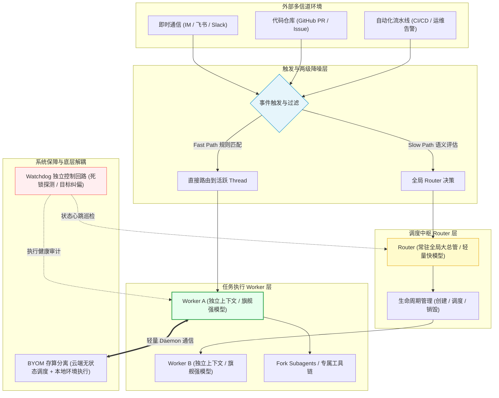

> 近一年来，随着大语言模型基础推理能力与多智能体（Multi-Agent）技术的跃升，AI 正在经历一次深刻的分工演进：人类正从繁琐的底层代码实现与命令执行中逐步抽身，转向顶层的战略决策、架构设计与成果验收。然而，当单任务性能被前沿模型逐步攻克时，一个更严峻的系统级瓶颈悄然浮现——**人类的注意力带宽上限**。
> DeepSeek Harness（DSH）团队在《Super-agent 设计探索：迈向更自主的 Agent 系统》中，跳出浅层应用封装与上层提示词技巧，回归计算机科学体系结构的经典底层原语（虚拟内存分页、分层调度、分支预测、存算分离、控制回路），系统性地提出了一套兼具**连续、高效、主动、持久**特性的 Super-Agent 架构。本文将深入解构其背后的系统工程思想与技术落地细节。

<!-- more -->

---

## 📑 本文目录

- [一、背景与痛点：单任务与多任务的范式演化](#一、背景与痛点：单任务与多任务的范式演化)
  - [1.1 认知瓶颈转移：人类注意力成为系统的阿喀琉斯之踵](#1-1-认知瓶颈转移：人类注意力成为系统的阿喀琉斯之踵)
  - [1.2 Session 隔离之痛：为什么多会话与多 Agent 团队难以规模化？](#1-2-Session-隔离之痛：为什么多会话与多-Agent-团队难以规模化？)
  - [1.3 对比：Claude Code 的精简工作流 vs DSH 的跨任务系统架构](#1-3-对比：Claude-Code-的精简工作流-vs-DSH-的跨任务系统架构)
- [二、Super-Agent 总体设计：向经典计算机系统借鉴底层原语](#二、Super-Agent-总体设计：向经典计算机系统借鉴底层原语)
- [三、核心支柱一·双层架构（Router 与 Worker 的权衡艺术）](#三、核心支柱一·双层架构（Router-与-Worker-的权衡艺术）)
  - [3.1 连续性 vs 高吞吐的架构取舍](#3-1-连续性-vs-高吞吐的架构取舍)
  - [3.2 Router 层：常驻的全局大总管（低成本轻量决策）](#3-2-Router-层：常驻的全局大总管（低成本轻量决策）)
  - [3.3 Worker 层：隔离的高算力执行体（专业重型模型）](#3-3-Worker-层：隔离的高算力执行体（专业重型模型）)
  - [3.4 用户视角的体验重塑：Session 彻底隐形](#3-4-用户视角的体验重塑：Session-彻底隐形)
- [四、核心支柱二·事件驱动与全生命周期调度](#四、核心支柱二·事件驱动与全生命周期调度)
  - [4.1 从“用户拉取（Pull）”到“环境触发（Trigger Push）”](#4-1-从“用户拉取（Pull）”到“环境触发（Trigger-Push）”)
  - [4.2 两级降噪过滤：Fast Path 与 Slow Path](#4-2-两级降噪过滤：Fast-Path-与-Slow-Path)
  - [4.3 Thread（事件线）与动态订阅直通路由](#4-3-Thread（事件线）与动态订阅直通路由)
  - [4.4 上下文预算控制：编译优化中的 Inline 与 Spill 策略](#4-4-上下文预算控制：编译优化中的-Inline-与-Spill-策略)
  - [4.5 链式召回（Chain of Recall）：拓扑引用图代替粗暴记忆库](#4-5-链式召回（Chain-of-Recall）：拓扑引用图代替粗暴记忆库)
  - [4.6 投机执行（Speculative Execution）：用后台算力换用户时间](#4-6-投机执行（Speculative-Execution）：用后台算力换用户时间)
- [五、核心支柱三·多信道异步全双工交互](#五、核心支柱三·多信道异步全双工交互)
  - [5.1 阻塞式 ReAct 与异步 ReAct Loop 的代际差异](#5-1-阻塞式-ReAct-与异步-ReAct-Loop-的代际差异)
  - [5.2 主流前沿产品的实现映射：Claude Code 与 ChatGPT](#5-2-主流前沿产品的实现映射：Claude-Code-与-ChatGPT)
- [六、核心支柱四·计算、状态与环境的三权分离（BYOM 架构）](#六、核心支柱四·计算、状态与环境的三权分离（BYOM-架构）)
  - [6.1 传统一体化部署的现实困境](#6-1-传统一体化部署的现实困境)
  - [6.2 计算与状态分离：无状态 Agent 运行时与持久化存储](#6-2-计算与状态分离：无状态-Agent-运行时与持久化存储)
  - [6.3 计算与环境分离：BYOM（Bring Your Own Machine）接入模型](#6-3-计算与环境分离：BYOM（Bring-Your-Own-Machine）接入模型)
- [七、核心支柱五·看门狗（Watchdog 外部控制回路）](#七、核心支柱五·看门狗（Watchdog-外部控制回路）)
  - [7.1 为什么传统的进程保活对 LLM 无效？](#7-1-为什么传统的进程保活对-LLM-无效？)
  - [7.2 作为独立 Session 的 Watchdog 控制回路](#7-2-作为独立-Session-的-Watchdog-控制回路)
- [八、总结与深度思考：从上层玩具走向底层系统工程](#八、总结与深度思考：从上层玩具走向底层系统工程)

---

## 一、背景与痛点：单任务与多任务的范式演化

### 1.1 认知瓶颈转移：人类注意力成为系统的阿喀琉斯之踵

过去一年，以 OpenClaw、各类 coding agent 为代表的工具快速迭代，催生了所谓的 **Personal Agent（个人智能体）** 业态。

但经过实际工程检验可以发现：单纯将响应延迟做低、体验做顺滑，并不能从本质上提升生产力。其核心症结在于：

> **单任务的上限取决于模型能力，多任务的上限取决于人类注意力。**

当人类工程师面对复杂研发项目时，往往需要同时盯梢多个方向：需求沟通、代码实现、单元测试、CI/CD 修复、线上告警监听等。然而人脑的工作记忆极度有限，通常在**同时切换关注 3~5 个独立会话（Session）**时就会到达认知负荷的极限；一旦超过此阈值，上下文切换所带来的遗忘、漏看与决策混乱将呈指数级上升。

### 1.2 Session 隔离之痛：为什么多会话与多 Agent 团队难以规模化？

目前主流 Agent 系统普遍以单一 Session（会话）为基本组织单元。多会话模式暴露出几大根本性缺陷：
1. **会话孤岛与状态割裂**：每个会话拥有完全独立的上下文，跨会话同步信息必须依赖人工复制粘贴或外部低效检索；
2. **单会话同步阻塞**：当 Agent 正在执行耗时较长的自动化测试或构建任务时，整个会话处于挂起阻塞状态，人类无法即时插入新指令；
3. **人类沦为低效项目经理**：在很多声称支持 Multi-Agent 的开源项目（如 Agent Teams）中，系统把分解任务、协调进度、合并成果的重担全盘甩给了用户。

即使借助 MCP（Model Context Protocol）扩展了外部工具边界，上下文窗口被海量工具定义撑爆、长程记忆注意力稀释的问题依然无解。

基于此，DeepSeek Harness 团队提出了 **Super-Agent** 架构：**彻底打破单任务间的会话物理壁垒，让智能体能够在跨任务、跨会话、跨生命周期中自如推进，在底层屏蔽会话概念，呈现为一个无缝统一的超级智能体。**

### 1.3 对比：Claude Code 的精简工作流 vs DSH 的跨任务系统架构

为了更好地理解 DSH 的立论点，我们不妨将其与当前另一主流标杆 **Claude Code** 进行横向对比：

| 架构维度 | Claude Code 模式 | DSH Super-Agent 模式 |
| :--- | :--- | :--- |
| **设计核心** | 单 Agent + Main Loop | 双层路由 + 事件驱动网络 |
| **关注焦点** | **单一任务内部**的推理精简与低延迟 | **一组任务长期并行推进**与跨上下文调度 |
| **子代理处理** | 将常规子任务提炼为标准 Skills，仅保留轻量 Tool 调用 | 形成轻量 Router + 独立专业 Worker 层次解耦 |
| **用户角色** | 人类在终端主循环中与主 Agent 密集对话 | 人类定义意图并验收，底层全自动分流执行 |

简言之：**Claude Code 致力于精简任务内部的交互链路，消除多角色传球时的信息失真；而 DSH 致力于在宏观尺度上组织跨任务、跨信道的长期自主并行。**

---

## 二、Super-Agent 总体设计：向经典计算机系统借鉴底层原语

在 DSH 的构想中，一个理想的 Super-Agent 应当能够在即时通信群组（IM）、代码仓库（GitHub）、持续集成环境（CI）之间自发穿梭：在群聊中捕获技术讨论，评估复现问题，自动关联代码与 PR，提交修复分支并反馈进展。

这种架构展现出四大核心能力特征：
- **连续性（Continuity）**：任务上下文跨越时间与环境持久流转；
- **高效性（High Throughput）**：高并发处理多线事务而不相互污染；
- **主动性（Proactivity）**：由被动响应提问转变为环境驱动自发行动；
- **持久性（Persistence）**：具备状态解耦与故障自愈的长期驻留能力。

此前很多极客尝试过基于单一 ReAct `/loop` 循环编写定时轮询脚本（如同时挂载监听 GitHub、社媒反馈与代码巡检）：

但简单的死循环往往在长周期运行后演变为不可预测的模型死锁或上下文崩溃。DSH 团队意识到：**上层的应用逻辑封装已触碰天花板，真正可行的 Agent 架构必须回归经典计算机体系结构的系统原语——会话共享、缓存机制、进程 Fork、工作树隔离与外部监控回路。**

由此，DSH 提炼出五大核心架构支柱：

---

## 三、核心支柱一·双层架构（Router 与 Worker 的权衡艺术）

### 3.1 连续性 vs 高吞吐的架构取舍

在系统底层，多任务并行天然面临着**吞吐量（Throughput）与连续性（Continuity）的矛盾**：
- **方案 A：全交给单个全局 Session**  
  全局上下文保持极好，但单线程串行执行，模型必须在单窗口内处理千头万绪，吞吐量低下且极易注意力稀释；
- **方案 B：全交给海量独立 Session**  
  并发吞吐极高，但会话彼此完全隔离，状态无法共享，再次将协调成本转嫁给人类。

DSH 给出的解法是：**分层解耦，构建 Router + Worker 双层体系结构。**

### 3.2 Router 层：常驻的全局大总管（低成本轻量决策）

- **职责**：作为系统的全局中枢，负责统一对外交互、意图路由、多任务统筹与状态汇总。它**绝不亲自下场执行具体的代码修改或繁重计算**；
- **模型选型**：由于 Router 只需进行分类、分流与全局调度，**选用低延迟、低成本的轻量级模型即可胜任**，以毫秒级响应支撑高频调度；
- **架构特性**：Router 本身支持分布式多节点部署，类似于微服务中的网关集群，仅负责元数据流转。

### 3.3 Worker 层：隔离的高算力执行体（专业重型模型）

- **职责**：承接由 Router 分发的具体任务单元。每个 Worker 拥有**完全隔离的独立上下文窗口与工作目录**，挂载针对该任务定制的专属工具链与权限；
- **模型选型**：由于涉及深度的代码重构、黑盒调试与复杂推理，Worker 必须配置算力最强、推理深度最深的**旗舰重型模型**；
- **嵌套能力**：单个 Worker 内部支持自由 `Fork` 子代理（Subagent），在自身管辖的小环境内按需派生专精团队。Worker 之间无需直接点对点通信，状态汇总由底层总线统一汇聚。

### 3.4 用户视角的体验重塑：Session 彻底隐形

在传统工具中，用户必须手动建立 Session、命名会话、记住每个会话在做什么。而在 Super-Agent 架构下：
- 底层自动化接管会话的分裂、挂起、唤醒与合并；
- **Session 这一中间概念对用户彻底隐形**：用户面对的始终是唯一的 Super-Agent，而底层正在有数十个 Worker 线程自主协同推进。

---

## 四、核心支柱二·事件驱动与全生命周期调度

### 4.1 从“用户拉取（Pull）”到“环境触发（Trigger Push）”

传统对话型 AI 采用“请求-响应”的被动拉取（Pull）模型。而在 Super-Agent 架构中，所有外生输入被抽象为统一的 **Trigger（触发器事件）**：
- 即时通信平台的一条讨论消息；
- 代码仓库的一个 Issue、PR 或 Review Comment；
- 监控平台触发的一条异常报警；
- CI 流水线失败的一个 Webhook 回调。

有了 Trigger，系统便具备了自主巡航与主动感知的能力。

### 4.2 两级降噪过滤：Fast Path 与 Slow Path

接入真实生产环境后，绝大部分系统事件属于低信噪比杂音（如 Bot 自言自语、无意义的表情点赞、常规轮询状态更新）。如果无脑调用大模型判断，将造成灾难性的 Token 浪费与系统拥堵。

DSH 引入了类似现代 CPU 缓存分层的**两级降噪机制**：

1. **第一级·程序层过滤（Fast Path）**：  
   基于确定性的规则引擎、正则表达式、黑白名单与事件元数据（如发送者身份、消息标签）进行瞬时过滤。**绝大部分无效事件在此被拦截，耗时 < 1ms，0 Token 成本**；
2. **第二级·语义层过滤（Slow Path）**：  
   通过第一级的疑似有效事件被投递给轻量级判定模型，由其结合精简的系统策略 Prompt 与微缩上下文，决策该事件是否需要启动 Agent 介入。

### 4.3 Thread（事件线）与动态订阅直通路由

在 DSH 的抽象中：
- 单个事件称为 **Trigger**（散落的点）；
- 具备因果延续与上下文关联的事件流称为 **Thread**（连贯的线）。

例如：GitHub 上某一个特定 PR 的全部变动与评论，或者邮件列表中针对同一主题的往复邮件，各自构成独立的 Thread。

当新事件进入系统时，路由机制同样分化为两条路径：

- **Cold Start（慢速初始化）**：如果出现的 Thread 从未被注册，由全局 Router 介入仲裁任务归属，分派并实例化一个新的 Worker 进行订阅；
- **Fast Path（直通分发）**：若该 Thread 已有活跃的 Worker 负责，后续事件经降噪后**绕过全局 Router，直接投递给对应的 Worker 实例**，有效避免中枢瓶颈。

### 4.4 上下文预算控制：编译优化中的 Inline 与 Spill 策略

当任务事件被派发给 Worker 后，核心难题演变为：**如何组织当前推理的上下文？**
- 注入过多：上下文窗口被大量低频历史占满，推理成本飙升且引起注意力分散（Attention Dilution）；
- 注入过少：模型因信息匮乏而频繁发起工具查询，造成来回往返的“工具颠簸（Tool Thrashing）”。

DSH 团队从编译器优化中汲取灵感，提出了 **Inline（内联）与 Spill（溢出）** 的上下文预算控制法则：

- **Inline（内联）**：将近期推理判定大概率会高频访问的核心信息（如关键报错栈、当前修改的函数体、直接任务指令）直接组装进 Prompt 上下文，免除工具往返开销；
- **Spill（溢出）**：将超长文档、完整调用日志、依赖锁文件等低频信息保留在上下文窗口之外（沉淀于持久化文件或向量索引中），而在上下文中仅留存一个**结构化引用指针（URI / ID + 摘要）**。

> **💡 深入思考：LLM 上下文管理与 OS 虚拟内存分页的区别**  
> 这一机制在直觉上酷似操作系统的虚拟内存换入换出（Page Swapping）：常用页置于物理内存（Context Window），低频页置换至磁盘交换区（External Storage）。  
> 但二者存在本质区别：**操作系统的缺页异常是由硬件 MMU 与操作系统内核透明捕获处理的，用户程序毫无感知；而在大模型系统中，并没有底层硬件自动代劳——当数据被 Spill 溢出后，模型必须具备充分的“元认知能力（Meta-cognition）”，即主动意识到自身缺少特定上下文，并自发调用检索工具将其读回。** 这深刻解释了为什么相同的上下文管理策略在不同模型上表现差异巨大。

### 4.5 链式召回（Chain of Recall）：拓扑引用图代替粗暴记忆库

为了让被 Spill 出去的信息能够被精准追溯，DSH 引入了 **Chain of Recall（链式召回）** 机制。

系统对所有核心实体（Trigger、Thread、Worker、Commit、Artifact）赋予全局唯一 ID，并在指针注入时附加反向关联锚点。  
当用户在即时通信群组中提出模糊问题（如：“*昨天那个网络重试 Bug 修得怎么样了？*”）时，系统并不需要盲目在全量向量库中做漫无边际的语义碰撞，而是**像沿图遍历一样展开拓扑追踪**：

$$\text{IM Message} \longrightarrow \text{Thread ID} \longrightarrow \text{Assigned Worker} \longrightarrow \text{Task Graph} \longrightarrow \text{GitHub PR} \longrightarrow \text{Commit SHA}$$

以结构化图谱代替扁平化的“巨型外挂记忆库”，召回精度与因果溯源能力产生质的飞跃。

### 4.6 投机执行（Speculative Execution）：用后台算力换用户时间

现代高性能 CPU 为了克服流水线停顿，会基于分支预测器提前执行可能被执行的指令分支。DSH 将这一思想成功复刻至 Agent 编排层：

当环境捕获到强前置信号时（例如 CI 流水线抛出特定的测试用例失败错误），即便人类工程师尚未查看并发出指令，Worker 已经在后台沙箱中开启**投机推理**，尝试编写修复补丁并跑通回归验证。  
- 若人类随后指示“*请修复该 CI 报错*”，系统直接秒级交付已验证的成果；
- 若人类指示“*该测试用例将被弃用，无需处理*”，系统静默丢弃预计算分支。

**以充裕的后台边缘算力换取稀缺的人类时间**，是实现真正“主动式自主体”的核心范式跃迁。

---

## 五、核心支柱三·多信道异步全双工交互

### 5.1 阻塞式 ReAct 与异步 ReAct Loop 的代际差异

经典的 Agent 实现多建立在同步阻塞式的 ReAct（Reason + Act）循环之上。

- **旧范式（半双工阻塞）**：用户发出一句指令，调用 `run()` 后整个前端交互被死锁；用户只能干等工具一步步执行完毕，中途无法修正或追加要求；
- **新范式（全双工异步）**：交互接口升级为多信道异步状态机。当用户下达复杂长任务时，`start()` 瞬时返回就绪状态，ReAct 循环在后台独立拓扑推进，前台交互通道始终畅通无阻，随时接收人类的补充提示、约束微调甚至紧急熔断。

### 5.2 主流前沿产品的实现映射：Claude Code 与 ChatGPT

前沿产品在实现这种非阻塞交互时呈现出殊途同归的技术路径：
1. **Claude Code**：将会话内部的 Agent 严格划分为前台任务与后台任务。前台工具执行会短暂停顿控制台，而耗时巨大的长程任务（如全仓代码检索、大规模测试套件）派发至后台 Subagent 异步进行，完工后通过通知机制将差分补丁回显至主干；
2. **ChatGPT / Codex Desktop**：在长耗时代码沙箱或网页自动化运行期间，用户输入框始终保持活跃状态，支持在模型执行中途动态追加新的上下文条件。

---

## 六、核心支柱四·计算、状态与环境的三权分离（BYOM 架构）

### 6.1 传统一体化部署的现实困境

在早期的 Agent 开发框架中，**计算逻辑、状态会话与执行环境往往被耦合绑定在同一台物理机器上**。这种设计在面对现实工业生产时面临双重困境：
- **云端纯沙箱难以复现本地真相**：现实开发依赖机器本地未提交的 Git 暂存区、私有内网 VPN、复杂的硬件环境与特定的本地编译链。若将整个开发环境强行搬迁上云，往往因为环境漂移而产出大量“云端能跑、本地跑死”的无效代码；
- **本地强耦合难以长久常驻**：若完全绑定在本地机器上，开发者一旦合上笔记本或遭遇网络闪断，运行中的会话便戛然而止。

### 6.2 计算与状态分离：无状态 Agent 运行时与持久化存储

DSH 实现了彻底的解耦拆解：
- **无状态计算（Compute）**：将 Agent 的决策循环运行在云端轻量、弹性的无状态容器集群中，任何单个计算节点发生崩溃或调度迁移，均可被透明重建；
- **外置持久化状态（State）**：任务拓扑树、会话图谱、环境变量与中间产物解耦保存在高可用的外部状态存储与数据库中，确保生命周期持久延续。

### 6.3 计算与环境分离：BYOM（Bring Your Own Machine）接入模型

针对代码执行与调试，DSH 确立了 **BYOM（Bring Your Own Machine）** 的混合拓扑架构：

- **核心原则**：不搬迁用户的开发环境，让代码与依赖老老实实保留在开发者最熟悉的本地物理机器上；
- **轻量端侧 Daemon**：本地机器仅需部署一个经过安全认证的轻量代理守护进程（Daemon），云端无状态 Super-Agent 仅向 Daemon 下发离散的原子执行命令并回传执行输出（stdout/stderr）；
- **动态纳管**：一台仅在白天联网的办公笔记本、一台边缘工控机或云端测试集群，均可作为动态环境节点无缝挂载。

---

## 七、核心支柱五·看门狗（Watchdog 外部控制回路）

### 7.1 为什么传统的进程保活对 LLM 无效？

在传统的分布式后端系统运维中，高可用主要依靠心跳检测与进程守护（如 Supervisor、K8s Liveness Probe）。一旦进程崩溃，自动拉起重启即可解决大部分问题。

但在大语言模型驱动的自主体系统中，**传统的存活探针彻底失效**：
- 系统的操作系统进程正常、CPU 使用率居高不下、网络连接完好；
- **但智能体本身却已陷入了“认知死锁”**：反复调用无效工具死循环、陷入幻觉生成的复读状态，或者在多轮工具调用后发生了严重的**目标漂移（Goal Drift）**，完全偏离了人类最初设定的核心诉求。

### 7.2 作为独立 Session 的 Watchdog 控制回路

为了解决软性死锁难题，系统必须在主执行回路之外引入完全独立的外部监督回路——**Watchdog 控制系统**。

- **独立性与观察者视角**：Watchdog 自身作为一个高度精简、拥有独立上下文窗口的审计 Agent 定时被时钟中断唤醒；
- **异常研判与干预手段**：它静默审视正在运行的 Worker 的执行日志与工具调用序列。当检测到以下病态特征时立即介入：
  1. 连续多次调用同类型工具且返回无效结果；
  2. 生成内容长度超标且出现重复特征；
  3. 执行路径与规划树的余弦偏离度超出阈值。
- **治理动作**：Watchdog 拥有直接中断异常 Worker、重置局部上下文、向人类告警或注入修正 Prompt 强制引导回归主线的管理特权。

---

## 八、总结与深度思考：从上层玩具走向底层系统工程

纵观当前人工智能领域的浪潮，大量的热点集中于 Prompt 提示词的调优、上层 Tools 的堆砌或概念性的“团队角色扮演”。然而，受限于注意力机制（Self-Attention）在长上下文中的统计衰减特性，单纯在 Prompt 层面打补丁，往往无法解决复杂的工业级长程生产力问题。

DeepSeek Harness 团队提出的 Super-Agent 架构之所以具有极高的启发性，是因为它展示了**一种从应用层炒作向底层系统工程（System Engineering）扎实演进的正确范式**：

1. **认知边界的清醒划分**：认识到多任务瓶颈在于人类注意力，从而主动接管会话管理，让 Session 彻底退出用户感知；
2. **经典计算思想的深度映射**：从操作系统分层、虚拟内存缺页调页、CPU 投机执行、存算分离到独立看门狗控制回路，计算机科学过去半个世纪沉淀的架构瑰宝在大模型时代焕发新生；
3. **面向现实复杂度的架构妥协**：不盲目追求纯云端全能化，而是通过 BYOM 架构拥抱异构、不稳定的真实本地开发环境。

当 Agent 框架开始从“玩具式的自动化脚本”转向“严肃的工业级分布式系统”时，迈向更通用、更自主的智能协作时代才真正迎来了可落地的坚实基石。
