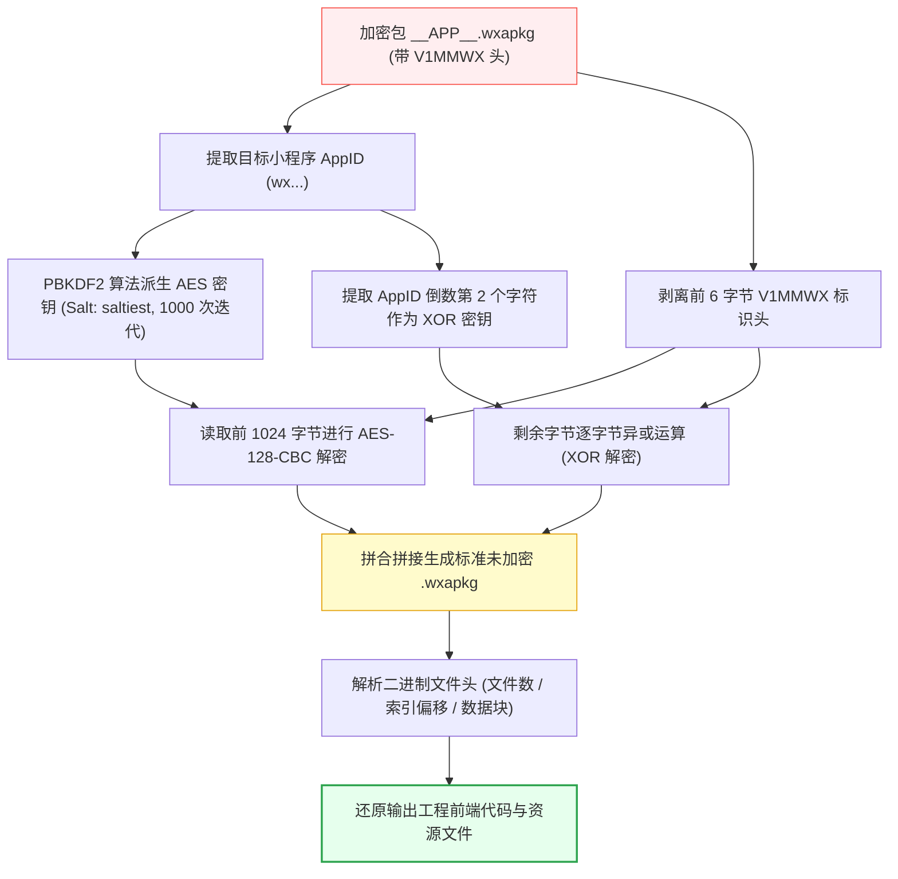
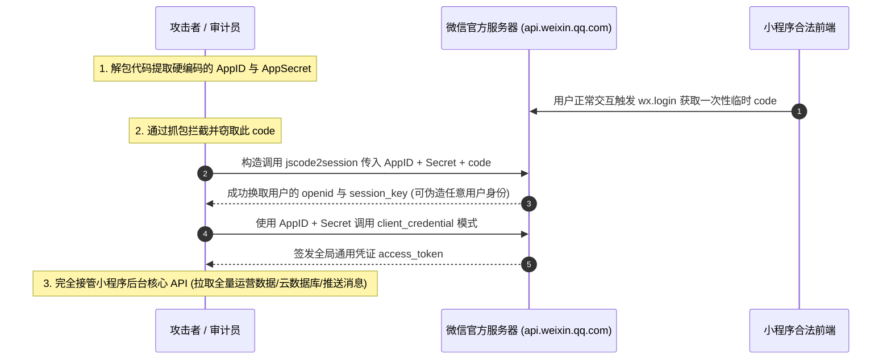

> 本文系统性梳理 Windows 环境下微信小程序安装包（`__APP__.wxapkg`）的提取、外层 `V1MMWX` 混淆解密、工程还原以及安全合规审计全流程。特别针对**新版微信（v4.x / Radium 架构）中缓存路径发生重大变迁**、导致主流解包工具 `scan` 扫描失败的痛点问题（详见 [wux1an/wxapkg Issue #49](https://github.com/wux1an/wxapkg/issues/49)），给出了全套可落地的解决方案与底层原理剖析。

<!-- more -->

---

## 📑 本文目录

- [一、微信小程序包（wxapkg）的底层认知](#一、微信小程序包（wxapkg）的底层认知)
  - [1.1 小程序包机制与双线程模型](#1-1-小程序包机制与双线程模型)
  - [1.2 PC 端与移动端存储差异](#1-2-PC-端与移动端存储差异)
- [二、重磅坑点：新版微信 v4 路径变迁与踩坑修复（Issue #49）](#二、重磅坑点：新版微信-v4-路径变迁与踩坑修复（Issue-49）)
  - [2.1 传统旧版路径（WeChat 3.x）](#2-1-传统旧版路径（WeChat-3-x）)
  - [2.2 现代新版路径（WeChat 4.x / Radium 架构）](#2-2-现代新版路径（WeChat-4-x-Radium-架构）)
  - [2.3 核心报错排查：为什么工具 scan 扫描不到小程序？](#2-3-核心报错排查：为什么工具-scan-扫描不到小程序？)
  - [2.4 解决方案一：命令行显式指定新版路径递归解包（推荐）](#2-4-解决方案一：命令行显式指定新版路径递归解包（推荐）)
  - [2.5 解决方案二：升级到 wxapkg v2.0+ GUI 跨平台版本](#2-5-解决方案二：升级到-wxapkg-v2-0-GUI-跨平台版本)
  - [2.6 解决方案三：源码改造自动适配扫描路径](#2-6-解决方案三：源码改造自动适配扫描路径)
- [三、Windows 端 wxapkg 外层加密与逆向解密原理](#三、Windows-端-wxapkg-外层加密与逆向解密原理)
  - [3.1 为什么 PC 端需要二次解密？](#3-1-为什么-PC-端需要二次解密？)
  - [3.2 微信官方加密流水线（V1MMWX 格式）](#3-2-微信官方加密流水线（V1MMWX-格式）)
  - [3.3 逆向解密核心流程图解](#3-3-逆向解密核心流程图解)
  - [3.4 解密工具实战调用](#3-4-解密工具实战调用)
- [四、小程序解包与工程还原实战](#四、小程序解包与工程还原实战)
  - [4.1 现代一站式解包工具选型对比](#4-1-现代一站式解包工具选型对比)
  - [4.2 解包生成的核心中间文件解析](#4-2-解包生成的核心中间文件解析)
  - [4.3 主包与分包（Subpackages）合并还原](#4-3-主包与分包（Subpackages）合并还原)
- [五、解包后资产审计与高危信息泄露面](#五、解包后资产审计与高危信息泄露面)
  - [5.1 硬编码 AppID 与 AppSecret（接管小程序）](#5-1-硬编码-AppID-与-AppSecret（接管小程序）)
  - [5.2 敏感后端 API 与接口越权审计](#5-2-敏感后端-API-与接口越权审计)
  - [5.3 前端硬编码加密密钥泄露](#5-3-前端硬编码加密密钥泄露)
  - [5.4 微信云开发（CloudBase）未授权滥用](#5-4-微信云开发（CloudBase）未授权滥用)
- [六、安全防护与代码加固建议](#六、安全防护与代码加固建议)
- [七、免责声明](#七、免责声明)

---

## 一、微信小程序包（wxapkg）的底层认知

### 1.1 小程序包机制与双线程模型

微信小程序在架构上采用了经典的**双线程运行模型**：
- **逻辑层（AppService）**：运行在独立的 JS 虚拟机中，负责业务逻辑流转、数据请求和状态更新；
- **渲染层（WebView）**：每个页面对应独立的 WebView，负责 WXML 节点树解析与 WXSS 样式排版。

开发者在微信开发者工具中编写的完整前端项目，经过编译压缩后，最终会被打包为一个以 `.wxapkg` 结尾的单一二进制文件下发给终端运行。

### 1.2 PC 端与移动端存储差异

在不同的终端操作系统上，微信对小程序包的处理方式存在显著差异：

- **Android 移动端**：
  文件默认保存在私有目录 `/data/data/com.tencent.mm/MicroMsg/{User_Hash}/appbrand/pkg/` 下（需 Root 权限访问）。移动端下载的 `.wxapkg` 文件通常**未经过外层二次加密**，解包工具可直接识别二进制结构。
- **Windows PC 端**：
  为了防止用户在本地直接提取代码，Windows 版微信在 `.wxapkg` 原始二进制包的外层**额外施加了一层混合加密**，并在文件头部植入了醒目的 `V1MMWX` 标识：


只有先将这层包装剥离，才能还原为标准的未加密 `.wxapkg` 包。

---

## 二、重磅坑点：新版微信 v4 路径变迁与踩坑修复（Issue #49）

在很长一段时间里，网上的绝大部分逆向教程都写着统一的路径。但随着微信 Windows 版升级到 **4.x 架构（基于 Radium 全新内核重构）**后，成千上万的开发者和安全研究员发现：**去原来的目录翻找，发现里面要么空空如也，要么只有很多个月以前的老旧包！**

很多解包工具（如著名开源项目 [wux1an/wxapkg](https://github.com/wux1an/wxapkg) 在 v1.5 及更早版本时）的自动扫描命令直接报错崩溃（见 [Issue #49](https://github.com/wux1an/wxapkg/issues/49)）。

### 2.1 传统旧版路径（WeChat 3.x）

旧版微信的小程序缓存全部存放在用户的“我的文档”目录下：

```text
C:\Users\<你的Windows用户名>\Documents\WeChat Files\Applet\<wx_appid>\<版本号>\__APP__.wxapkg
```

### 2.2 现代新版路径（WeChat 4.x / Radium 架构）

微信 4.0 进行了跨平台统一架构重塑，不仅运行环境全面迁移，小程序的安装与数据缓存路径也彻底移至 `AppData\Roaming` 目录下：

#### 路径形态 A（全局安装目录）：
```text
C:\Users\<用户名>\AppData\Roaming\Tencent\xwechat\radium\Applet\packages\<wx_appid>\
```
*(注：部分更新版本位于 `...\Tencent\WeChat\radium\Applet\packages\<wx_appid>\`)*

#### 路径形态 B（多用户隔离目录，当前最常见形态）：
```text
C:\Users\<用户名>\AppData\Roaming\Tencent\xwechat\radium\users\<用户哈希ID>\applet\packages\<wx_appid>\<版本号>\__APP__.wxapkg
```

> 💡 **快速定位技巧**：按下键盘快捷键 `Win + R`，输入 `%APPDATA%\Tencent` 并回车，在搜索框中直接搜索 `__APP__.wxapkg`，即可按修改时间瞬间找出刚刚在微信中点开的小程序！

### 2.3 核心报错排查：为什么工具 scan 扫描不到小程序？

在工具 `wxapkg` 中执行：
```bash
wxapkg.exe scan
```
会触发如下错误：
```text
runtime error: index out of range [0] with length 0
goroutine 1 [running]:
github.com/wux1an/wxapkg/cmd.(*scanTui).renderDetail(...)
```
**根因分析**：
工具源码内写死了扫描路径为 `Documents\WeChat Files\Applet`。当检测到主机已迁移至新版微信或不存在旧版目录时，读取到的文件列表长度为 0，数组越界直接抛出 panic。

### 2.4 解决方案一：命令行显式指定新版路径递归解包（推荐）

这是无需升级或重新编译工具的最简单直观方案。通过 `unpack` 子命令配合 `-r`（递归遍历目录），直接指向新版实际存放的路径：

```bash
# 替换为你自己电脑中的实际路径
wxapkg_1.5.0_windows_amd64.exe unpack -r "C:\Users\<用户名>\AppData\Roaming\Tencent\xwechat\radium\users\<用户哈希>\applet\packages\<wx_appid>"
```

执行后，工具会自动：
1. 抓取目录下的 `__APP__.wxapkg` 以及全部子分包文件；
2. 自动检测并解密 `V1MMWX` 加密外壳；
3. 将解包还原出的完整代码提取到同级输出目录中。

### 2.5 解决方案二：升级到 wxapkg v2.0+ GUI 跨平台版本

针对此问题，作者已在后续的 `v2.0.0` 大版本中采用 Wails2 重构了图形界面：
- 原生支持自动兼容检测 **微信 v3 与 v4 版本** 的小程序安装路径；
- 提供可视化的勾选列表，直接勾选对应的小程序一键完成解包；
- 建议前往项目的 [Releases 页面](https://github.com/wux1an/wxapkg/releases) 下载最新的 GUI 版本。

### 2.6 解决方案三：源码改造自动适配扫描路径

如果你习惯使用自编译的 CLI 版本，可以直接修改源码中的扫描逻辑：
在 `cmd/scan.go` 中，将原有的单一路径扩展为新旧路径切片：

```go
// 扩展默认扫描路径候选列表
var defaultAppletPaths = []string{
    filepath.Join(userHome, "Documents", "WeChat Files", "Applet"),
    filepath.Join(appData, "Tencent", "xwechat", "radium", "Applet", "packages"),
    filepath.Join(appData, "Tencent", "WeChat", "radium", "Applet", "packages"),
}
```
重新执行 `go build` 即可让 `scan` 命令在新版微信下恢复自动化扫描。

---

## 三、Windows 端 wxapkg 外层加密与逆向解密原理

### 3.1 为什么 PC 端需要二次解密？

微信官方通过在 PC 端增设一层基于设备与 AppID 的专有对称加密，使得即使文件存储在开放的文件系统上，也无法被常规的 7-Zip、WinRAR 或通用解包器识别。

### 3.2 微信官方加密流水线（V1MMWX 格式）

经过安全社区的深入逆向，PC 端小程序的加密算法完全公开，其流水线如下：

1. **密钥派生（PBKDF2）**：
   - 密码原串（Passphrase）：小程序的 `AppID` 字符串（如 `wx1234567890abcdef`）；
   - 盐值（Salt）：固定英文字符串 `"saltiest"`；
   - 迭代次数（Iterations）：`1000`；
   - 哈希算法：SHA-1；
   - 派生生成：一个 **32 字节（256 位）的 AES 密钥**。
2. **IV 与对称加密（AES-128-CBC）**：
   - 固定初始化向量（IV）：长度为 16 字节的预设固定值（`"the iv: 16 bytes"`）；
   - 截取未加密 `.wxapkg` 原始包的**前 1024 字节**，使用派生出的密钥进行 AES 解密/加密。
3. **异或混淆（XOR 掩码）**：
   - 针对原始数据从第 1025 字节开始的剩余全量字节，采用异或密钥逐字节还原；
   - 异或密钥为该小程序 `AppID` 字符串的**倒数第二个字符**（若 AppID 长度小于 2，则固定回退至 `0x66`）。
4. **注入特征头**：
   - 将 6 字节的魔数 `V1MMWX` 写入文件最开头，紧跟 1024 字节的 AES 密文，最后拼接 XOR 密文流。

### 3.3 逆向解密核心流程图解



### 3.4 解密工具实战调用

在无需完整解包、仅需还原未加密 `.wxapkg` 的场景下，可以使用专用的解密工具 [BlackTrace/pc_wxapkg_decrypt](https://github.com/BlackTrace/pc_wxapkg_decrypt)：

```bash
# 语法格式：pc_wxapkg_decrypt.exe -wxid <小程序AppID> -in <加密文件路径> -out <解密后输出路径>
pc_wxapkg_decrypt.exe -wxid wx3b0f48xxxa2d4f94 -in __APP__.wxapkg -out decrypted.wxapkg
```

解密成功后，得到的文件头将恢复为小程序的标准二进制魔数 `0xBE`，内部结构即为标准的文件元数据索引表：


---

## 四、小程序解包与工程还原实战

### 4.1 现代一站式解包工具选型对比

| 工具名称 | 语言生态 | 分包合并支持 | 新版微信 v4 支持 | 维护状态与适用场景 |
| :--- | :--- | :--- | :--- | :--- |
| **`wux1an/wxapkg`** | Go / Wails2 | ✅ 完美自动合并 | ✅ 支持（需指定路径或用 v2+） | **强烈推荐**。集成解密+解包+JS美化，支持 GUI 与 CLI。 |
| **`pc_wxapkg_decrypt`** | Go | 仅负责解密 | 需手动传入文件 | 纯净解密器，适合嵌入自定义自动化脚本。 |
| **`wxappUnpacker`** | Node.js | ⚠️ 需手动依赖注入 | ❌ 不直接支持 V1MMWX | 早期开源先驱，目前依赖库严重过时，解析 ES6 易报错。 |
| **`Integ/python.py`** | Python 3 | ❌ 仅支持基础单包 | ❌ 仅支持明文包 | 轻量简短，适合学习 wxapkg 结构二进制 unpack 算法。 |

### 4.2 解包生成的核心中间文件解析

标准解包完成后，项目根目录下通常会输出如下核心文件：

```text
├── app-service.js     # 【逻辑层大汇总】整个小程序全部 JS 业务代码被合并压缩至此
├── app-config.json    # 【配置中枢】合并了原始 app.json 与所有页面的窗口/路由配置
├── page-frame.html    # 【视图模板层】包含全部页面的 WXML 编译后模板与全局 WXSS 样式
├── pages/             # 拆解还原出的各个页面目录（包含对应页面的独立 JS/JSON/WXSS/WXML）
└── static/            # 小程序自带的本地图标、图片、音视频等静态媒体素材
```

现代解包器（如 `wxapkg`）内置了 AST 抽象语法树解析器，会自动解析 `app-service.js` 中的 `define("pages/index/index.js", ...)` 闭包声明，将合并的大文件重新分散还原为原汁原味的单文件源码结构。

### 4.3 主包与分包（Subpackages）合并还原

为了突破小程序 2MB/20MB 的体积限制，主流商业小程序几乎都采用了分包机制：
- 主包通常命名为 `__APP__.wxapkg`；
- 分包文件通常以 `sub-xxx.wxapkg` 或独立哈希命名存放在同级目录中。

**踩坑警示**：如果单独只解包主包，你会发现很多业务页面缺失、跳转 404。使用现代工具解包时，**务必将包含主包与所有子包的整个目录作为目标传入**，工具会自动读取 `app-config.json` 中的 `subpackages` 声明，完成代码的按需归位与依赖挂载。

---

## 五、解包后资产审计与高危信息泄露面

获取到完整的前端源码后，不仅能用于前端开发学习与架构复盘，更重要的是进行**企业级安全自查与渗透测试审计**。以下是逆向过程中最常见的高危信息泄露面：

### 5.1 硬编码 AppID 与 AppSecret（接管小程序）

部分不规范的开发者因图省事，将敏感的 `AppSecret`（小程序应用密钥）直接写死在前端代码中：


#### 攻击利用链时序图



#### 关键接口验证代码规范化

官方登录凭证校验接口 `code2Session`：

```bash
curl "https://api.weixin.qq.com/sns/jscode2session?appid=wxxxxxxx&secret=568wdxxxxxxx&js_code=041xxxxxxx&grant_type=authorization_code"
```

获取小程序后台全局接口凭证 `access_token`：

```http
GET https://api.weixin.qq.com/cgi-bin/token?grant_type=client_credential&appid=YOUR_APPID&secret=YOUR_APPSECRET
```

### 5.2 敏感后端 API 与接口越权审计

在 `app-service.js` 中全局全局搜索以下关键词：
- `url:`、`baseURL`、`api/`、`http://`、`https://`
- `admin`、`manage`、`upload`、`export`

经常能快速挖掘出：
1. **未公开的内部管理后台接口**；
2. **测试环境 API 地址**（如 `test-api.example.com`、`dev-api...`，往往缺少生产环境严格的 WAF 与鉴权防护）；
3. **接口水平/垂直越权漏洞**：小程序前端直接向接口传递 `userId=1001`，后端未校验 Session/Token 归属，导致修改 ID 即可遍历窃取其他用户的隐私数据。

### 5.3 前端硬编码加密密钥泄露

很多金融、电商或政企小程序为了防止抓包篡改，在客户端封装了“自以为安全”的加密机制：
- 在 JS 代码中直接明文硬编码 AES 密钥（如 `const AES_KEY = "1234567890123456"`）或国密 SM4 Key；
- 前端用此密钥加密请求体后发给服务端。解包后密钥直接裸奔，安全审计员可瞬间编写本地解密脚本，对加密通信实现“透明化重放与篡改”。

### 5.4 微信云开发（CloudBase）未授权滥用

部分小程序采用微信云开发，若开发者在云开发控制台中将数据库权限配置为错误的“所有用户可读写”：

```python
# 规范格式化后的云函数环境数据查询脚本示例
import os
from weixin import WxAppCloudAPI

appid = os.environ.get("WXAPP_APPID", "wx8888888888888888")
secret = os.environ.get("WXAPP_SECRET", "56xxxxxxxxxxxxxxxxxxxx")
env_id = "test-prod-env"

# 1. 换取云接口授权 Token
app_cloud = WxAppCloudAPI(appid=appid, app_secret=secret, grant_type="client_credential")
token = app_cloud.client_credential_for_access_token().get("access_token")
print(f"[*] Access Token: {token}")

# 2. 调用云开发数据库接口遍历集合数据
cloud_api = WxAppCloudAPI(access_token=token)
db_info = cloud_api.db_collection_info(json_body={"env": env_id, "limit": 10})
print(f"[*] Cloud Database Collections: {db_info}")
```

攻击者若拿到 `AppSecret`，即可直接绕过前端，随意导出整张用户表或执行批量删除操作。

---

## 六、安全防护与代码加固建议

基于上述常见的安全缺陷，企业与开发者应在发布前筑牢以下四道防线：

1. **红线原则：严禁在前端存放任何凭证密钥**
   `AppSecret`、各种云厂商的 `AccessKeyId/AccessKeySecret` 必须且只能保存在企业自建的安全后端服务器中。前端仅负责通过 `wx.login` 获取临时 `code` 发送给自建后端，由自建后端向微信官方服务器代理发起认证。
2. **零信任接口设计：后端强制实施身份与权限绑定**
   接口传参切勿信任前端传入的 `userId`、`roleId`。必须通过后端 Session / JWT 解析当前登录人的真实身份，并做细粒度的越权（IDOR）校验。
3. **敏感逻辑后置与代码深度混淆**
   - 核心风控算法、加解密过程应当移至后端完成；
   - 生产打包时务必开启代码深度压缩、变量名短化与控制流平坦化混淆，增加逆向理解门槛。
4. **收紧云开发安全规则**
   全面关闭“所有用户可读写”的宽松策略，将安全规则设置为严格的私有读写或仅服务端（Admin）可写。

---

## 七、免责声明

> **法律与道德红线**：  
> 本文所涉及的小程序解密解包技术、逆向分析思路以及安全审计方法，**仅供软件工程学习、系统安全架构研究以及企业合规自查参考**。  
> 严禁将本文内容用于侵犯他人知识产权、未授权渗透攻击、商业窃密或任何违法犯罪行为。因非授权操作引发的一切直接或间接法律责任，均由操作者本人自行承担。
