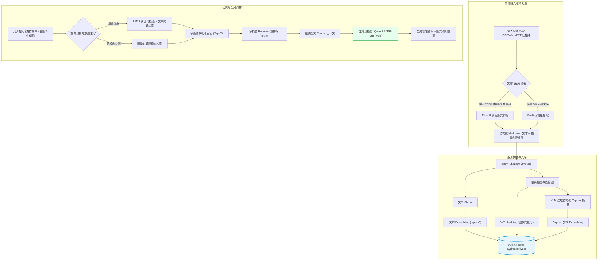

在当今企业私有化知识库与技术文档问答场景中，传统的纯文本 RAG（检索增强生成）已经难堪重负。现实中的工程图纸、财报图表、学术论文和设备操作手册往往充斥着复杂的**双栏混排、跨页表格、公式以及极其关键的内嵌插图**。

本文深度剖析一套面向生产环境的高性能**本地多模态 RAG / Agent 知识库系统架构**：
1. **推理主脑**：选用原生多模态 MoE 架构 **Qwen3.6-35B-A3B**（总参 35B，单 Token 激活 3B），兼顾大模型推理上限与极低显存成本；
2. **文档解析层**：采用 **MinerU + Docling** 异构双解析引擎组合兜底，彻底解决版面错乱、表格断裂与图片漏抽难题；
3. **图像双路机制**：拒绝盲目将所有原图直接喂入大模型，采用 **V-embedding（图像向量检索）+ VLM 结构化图像描述（Caption 摘要）** 并行方案，兼顾跨模态检索效率与可读上下文；
4. **切片与检索管道**：引入**层次分块（Parent-Child Chunking）**、**图文锚定（Image-Text Anchoring）**、**混合检索（BM25 + 向量）** 与 **多模态 Reranker**，构建严密闭环。

<!-- more -->

---

## 📑 本文目录

- [一、核心大脑：MoE 主推理模型选型（Qwen3.6-35B-A3B）](#一、核心大脑：MoE-主推理模型选型（Qwen3-6-35B-A3B）)
  - [1.1 为什么选用稀疏 MoE 替代传统稠密模型？](#1-1-为什么选用稀疏-MoE-替代传统稠密模型？)
  - [1.2 核心能力与系统定位](#1-2-核心能力与系统定位)
  - [1.3 本地部署引擎与显存优化（vLLM / SGLang）](#1-3-本地部署引擎与显存优化（vLLM-SGLang）)
- [二、文档解析层：MinerU + Docling 双引擎组合方案](#二、文档解析层：MinerU-Docling-双引擎组合方案)
  - [2.1 学术与复杂版式利器：MinerU（主力）](#2-1-学术与复杂版式利器：MinerU（主力）)
  - [2.2 轻量极速与 Office 原生支持：Docling（兜底）](#2-2-轻量极速与-Office-原生支持：Docling（兜底）)
  - [2.3 工程级异构分流与 Diff 校验策略](#2-3-工程级异构分流与-Diff-校验策略)
- [三、切片与索引：工业级多模态 Chunking 与元数据设计](#三、切片与索引：工业级多模态-Chunking-与元数据设计)
  - [3.1 基于 Markdown 标题树的层次分块（Parent-Child Chunking）](#3-1-基于-Markdown-标题树的层次分块（Parent-Child-Chunking）)
  - [3.2 图像与前后文的“图文锚定绑定（Image-Text Anchoring）”](#3-2-图像与前后文的“图文锚定绑定（Image-Text-Anchoring）”)
  - [3.3 向量数据库选型与命名多向量（Named Vectors）Schema](#3-3-向量数据库选型与命名多向量（Named-Vectors）Schema)
- [四、多模态检索：V-Embedding + 图像描述（Caption）双路机制](#四、多模态检索：V-Embedding-图像描述（Caption）双路机制)
  - [4.1 图像向量检索（V-Embedding）](#4-1-图像向量检索（V-Embedding）)
  - [4.2 VLM 结构化图像描述（Caption）](#4-2-VLM-结构化图像描述（Caption）)
  - [4.3 检索召回策略：双路配合与混合检索（Hybrid Search）](#4-3-检索召回策略：双路配合与混合检索（Hybrid-Search）)
  - [4.4 多模态重排器（Reranker）的最后把关](#4-4-多模态重排器（Reranker）的最后把关)
- [五、端到端数据流与完整 Pipeline 架构图](#五、端到端数据流与完整-Pipeline-架构图)
- [六、硬件配置清单与工程落地避坑指南](#六、硬件配置清单与工程落地避坑指南)
  - [6.1 私有化硬件部署阶梯推荐](#6-1-私有化硬件部署阶梯推荐)
  - [6.2 工业级实战四大工程坑点与应对对策](#6-2-工业级实战四大工程坑点与应对对策)
- [七、总结与未来展望](#七、总结与未来展望)

---

## 一、核心大脑：MoE 主推理模型选型（Qwen3.6-35B-A3B）

在本地私有化 RAG 架构中，模型的选择直接决定了系统的性能上限与硬件部署成本。以往很多本地部署常采用 7B/14B 级别的轻量稠密模型（或某些能力上限不足的小模型），但在多模态文档推理、复杂表格问答和 Agent 多步骤工具调用场景中，往往会出现**指令遵循度差、长文本遗忘、逻辑幻觉频发**等问题。

因此，本项目推荐将核心推理大脑升级为 **Qwen3.6-35B-A3B**。

### 1.1 为什么选用稀疏 MoE 替代传统稠密模型？

Qwen3.6-35B-A3B 是一款基于 **MoE（Mixture of Experts，混合专家）** 稀疏激活架构的原生多模态大模型：
- **总参数量 35B，每个 Token 仅激活 3B 参数**；
- **能力上限比肩大模型**：35B 的总参数量使其拥有丰富充沛的知识储备，在数学逻辑、代码生成（Agentic Coding）、复杂指令遵循与格式化输出方面表现优异；
- **推理成本媲美小模型**：由于每次前向推理只路由激活 3B 专家参数，其计算量（FLOPs）和推理延迟大幅降低，单卡即可获得极高吞吐；
- **原生多模态与超长上下文**：原生支持图像、高分辨率截图与图表解析，并具备高达 262K 的超长上下文窗口，极其适合海量检索资料的最终综合研判。

### 1.2 核心能力与系统定位

在知识库系统中，Qwen3.6-35B-A3B 承担以下三项关键职能：
1. **意图理解与检索重写（Query Rewriting）**：识别多轮对话中用户的代词或模糊意图，重构检索关键词；
2. **多模态图文综合研判**：同时接收检索召回的文档段落、表格 Markdown 以及关键匹配原图，进行交叉验证；
3. **结构化答案生成与溯源输出**：严格基于上下文生成回答，并精准标注引用的文档页码与图表来源。

### 1.3 本地部署引擎与显存优化（vLLM / SGLang）

- **推理引擎推荐**：优先选择针对 MoE 架构做了深度优化的 **vLLM** 或 **SGLang**，两者均原生支持 PagedAttention、连续批处理（Continuous Batching）与 MoE 路由内核加速；
- **量化与显存评估**：
  - **INT4 / AWQ 量化**：模型权重占用约 18~20GB 显存，加上 KV Cache 后，在**单张 24GB 显存消费级显卡（如 RTX 3090 / RTX 4090）**上即可跑通高并发推理；
  - **BF16 / FP16 全精度**：模型权重约需 70GB 显存，建议采用双卡 48GB（如 2×A6000 / 2×4090 D）或单卡 A100/H800。

---

## 二、文档解析层：MinerU + Docling 双引擎组合方案

> **RAG 领域的一句铁律：“Garbage in, Garbage out”（垃圾进，垃圾出）。**  
> 如果文档解析阶段把双栏排版读串行、把表格压成乱码、把插图遗失，后端的向量检索和模型推理再强大也无力回天。

传统基于单纯 OCR 或 PyPDF 的解析器无法理解复杂的学术排版与复杂表格。本项目采用 **MinerU** 与 **Docling** 互补协同的异构预处理方案。

### 2.1 学术与复杂版式利器：MinerU（主力）

- **核心强项**：
  - **深度版面分析（Layout Analysis）**：精准区分段落、页眉页脚、侧边栏、双栏/三栏文本流；
  - **复杂表格与跨页重构**：能将无线表、合并单元格表格精准转换为标准的 Markdown/HTML 表格；
  - **公式与图表转录**：行内公式与块级公式可高精度转为 LaTeX 语法；
  - **原图提取**：自动将文档内部嵌入的插图、矢量图抽离为独立高清文件，并保留原图在 Markdown 中的位置标识与标注文字。
- **局限与代价**：
  - 对 GPU 算力依赖较高（通常需要 8GB+ 独立显存运行视觉模型）；
  - 处理原生 Office 格式（docx、pptx）时，转换流程偶有冗余标签。

### 2.2 轻量极速与 Office 原生支持：Docling（兜底）

- **核心强项**：
  - 由 IBM 开源，底层专注于统一文档对象模型（Docling Document Model）；
  - **CPU 友好且运行极其轻量**，对常见排版的 PDF 和原生 Office 格式（Word、PowerPoint）解析速度极快；
  - 生成的纯文本 Markdown 结构极为干净、没有冗余噪点。
- **局限**：
  - 遇到严重扭曲、倾斜的低质量扫描件或极端复杂的多栏学术论文时，版面还原度略逊于 MinerU。

### 2.3 工程级异构分流与 Diff 校验策略

在实际文档接入管道（Ingestion Pipeline）中，推荐采用以下工程协同流程：

```
                    ┌──────────────┐
                    │ 待入库文档集 │
                    └──────┬───────┘
                           │
                 [ 文档类型与复杂度嗅探 ]
                           │
             ┌─────────────┴─────────────┐
             ▼                           ▼
    【扫描件/双栏/学术PDF】      【原生 Word/PPT/单栏文本】
             │                           │
      [ MinerU 解析 ]              [ Docling 解析 ]
             │                           │
             └─────────────┬─────────────┘
                           ▼
                  [ 输出统一标准 Markdown ]
                 + [ 抽离文档所有插图及坐标 ]
```

1. **自适应动态分流**：根据文件扩展名与首页版面预扫描特征，自动将扫描件及重度排版文件分配给 MinerU（GPU 任务队列），简单办公文档分配给 Docling（CPU 任务池）；
2. **边缘差异比对（Diff 校验）**：在核心关键业务（如合同、财务报表）场景下，同一文档可同时触发两套引擎，比对两者生成的表格行列数；若出现冲突，自动打标送入人机协同界面或调用轻量 VLM 二次复核。

---

## 三、切片与索引：工业级多模态 Chunking 与元数据设计

很多 RAG 项目解析完 Markdown 后，直接使用 `RecursiveCharacterTextSplitter` 按照 512 字符进行暴力截断，导致**表格被腰斩、代码块残缺、图片与上下文完全脱节**。

### 3.1 基于 Markdown 标题树的层次分块（Parent-Child Chunking）

在结构化 Markdown 的分块中，必须严格遵循**标题层级（Heading Hierarchy）**：
1. **标题面包屑继承（Breadcrumbs Injection）**：每一个切片文本的头部，必须自动拼装其所属的完整父级路径：
   ```markdown
   [文档源: 华为云原生操作手册.pdf] > [第3章: 网络配置] > [3.2 节: CNI 插件选型]
   ---
   (此处为本 Chunk 的具体正文内容...)
   ```
   *作用：即使该 Chunk 只有一两句话，也天然携带了完整的全局语义，大幅提升向量检索命中率。*
2. **表格不拆分原则**：对表格块做特殊标记保护。如果表格超过单个 Chunk 长度，可将其转为行级（Row-level）带全量表头的自包含切片。

### 3.2 图像与前后文的“图文锚定绑定（Image-Text Anchoring）”

文档中的插图绝不能孤立存放，脱离了前后文的图表往往毫无语义。
- **锚定上下文（Anchored Context）**：当抽取到图片 `figure_1.png` 时，系统必须抓取该图片在原文中**前后的段落正文（约 150~200 字）+ 原文档图注（Figure Caption）**；
- 将这段锚定文本作为图片的重要元数据，与后续生成的 VLM 图像描述进行二次融合。

### 3.3 向量数据库选型与命名多向量（Named Vectors）Schema

传统设计中，有人为图片和文本分别建立两套独立的向量数据库表，导致检索后还要进行繁琐的跨库 ID 拼接与同步。

推荐选用原生支持**多重命名向量（Named Vectors）**的现代向量数据库（如 **Qdrant** 或 **Milvus**）：

```json
// Qdrant / Milvus 单个 Point 存储结构设计示例
{
  "id": "chunk_doc_001_p12_img1",
  "vector": {
    "text_vector": [0.021, -0.045, 0.128, ...],    // 由 bge-m3 生成的文本嵌入 (1024维)
    "image_vector": [-0.012, 0.089, -0.034, ...]    // 由 V-embedding 生成的图像嵌入 (768维)
  },
  "payload": {
    "doc_id": "manual_v2.pdf",
    "page_idx": 12,
    "chunk_type": "image_with_caption",
    "title_path": "第三章 / 故障排查 / 图3-1 网络拓扑结构",
    "image_path": "/storage/images/manual_v2_p12_img1.webp",
    "anchored_text": "如图3-1所示，当核心交换机故障时，流量会自动倒换至备用链路...",
    "vlm_caption": "【网络拓扑示意图】图示包含三层交换机A与B，双上行链路连接至出口防火墙。图中红框标出了主备冗余链路的心跳检测IP...",
    "ocr_content": "SW-Core-01, 10.0.0.1, Active; SW-Core-02, 10.0.0.2, Standby"
  }
}
```

---

## 四、多模态检索：V-Embedding + 图像描述（Caption）双路机制

> 这是生产级多模态 RAG 的精髓：**“检索阶段用向量与文本快速召回，推理阶段按需将原图按图索骥喂给大模型”。**

如果每次查询都把海量原图丢给多模态大模型逐一扫读，系统吞吐会瞬间崩溃；而如果完全不存原图只保留文字描述，又会丢失关键视觉细节。

### 4.1 图像向量检索（V-Embedding）

- **选用模型**：`qwen-vl-embedding` 或 `bge-visualized`；
- **核心职能**：
  - **图搜图**：用户提问直接上传了一张报错截图或损坏零件照片，系统将其提取为图像向量，直接在向量空间中毫秒级召回知识库中最相似的故障图谱；
  - **跨模态文搜图**：用户输入“网络双机热备架构图”，模型利用图文对齐的共同潜空间，直接匹配到对应的拓扑图片。

### 4.2 VLM 结构化图像描述（Caption）

调用多模态模型（可直接复用 Qwen3.6-35B-A3B 或本地轻量级 VLM）对抽取出的图片进行离线预处理，强制按如下 **JSON 结构化 Prompt** 输出详细描述：

```json
{
  "image_type": "架构流程图 / 统计折线图 / 设备实物照 / 界面截图",
  "ocr_text": "图片内包含的所有清晰文字与数值标注",
  "key_findings": "该图表达的核心结论、主要趋势或关键故障提示",
  "visual_details": "颜色、红框标注、箭头指向等空间关系描述"
}
```

将该 Caption 文本合并入全文索引库。当用户输入文字提问时，即便没有图搜图模型，也能凭借高精度的 Caption 被标准文本检索轻松命中。

### 4.3 检索召回策略：双路配合与混合检索（Hybrid Search）

面对一个复杂的用户 Query，系统执行**多路并行召回**：
1. **路向 1（精准词法检索 BM25）**：使用内置的 BM25 引擎匹配专有名词、设备型号、代码函数名；
2. **路向 2（稠密语义检索 Dense Vector）**：利用文本 Embedding 检索文档段落及图像 Caption；
3. **路向 3（跨模态视觉检索 Visual Vector）**：若用户传入图片或具有显式图片检索意图，触发跨模态图像库检索。

### 4.4 多模态重排器（Reranker）的最后把关

多路召回会拉回 30~50 个候选 Chunk（包含文档片段与图片），此时必须通过 **Reranker（如 `bge-reranker-large` 或多模态重排器）** 进行打分：
- 剔除“看起来字面相关、实际答非所问”的干扰项；
- 精准筛选出 Top-3 到 Top-5 的黄金切片；
- 如果命中高分切片属于图片类型，则立即从本地持久化存储加载其**高清晰度原图路径**，连同**文档正文**一起打包组装成 Prompt，交给 Qwen3.6-35B-A3B 最终答复。

---

## 五、端到端数据流与完整 Pipeline 架构图

以下为整体架构的端到端数据流向（已严格适配 Mermaid 语法）：



---

## 六、硬件配置清单与工程落地避坑指南

### 6.1 私有化硬件部署阶梯推荐

| 部署层级 | 硬件配置推荐 | 适用场景与并发能力 |
| :--- | :--- | :--- |
| **单卡甜点级**<br>(极致性价比) | **GPU**：单卡 RTX 3090 / 4090 (24GB 显存)<br>**CPU**：16 核 32 线程 (Intel i7/i9 或 AMD 7900X)<br>**内存**：64GB DDR5<br>**存储**：1TB+ NVMe M.2 SSD | • Qwen3.6-35B-A3B 运行 INT4/AWQ 量化版本<br>• MinerU 与解析工作建议离线/闲时批处理，避免抢占显存<br>• 适合个人极客、工作室及 5~10 人小型团队内部使用 |
| **双卡企业级**<br>(标准生产配置) | **GPU**：双卡 RTX 4090 24G 或 双卡 RTX A6000 48G<br>**CPU**：AMD EPYC 或 Intel Xeon 32 核工作站<br>**内存**：128GB ECC DDR5<br>**存储**：2TB 企业级 NVMe SSD | • 卡 1 专属部署主推理模型（FP16/AWQ），保证问答毫秒级响应<br>• 卡 2 专属运行 MinerU、VLM Caption 生成与 Embedding/Rerank<br>• 动静分离，可轻松支撑 30~50 人企业并发问答与持续文档实时入库 |

### 6.2 工业级实战四大工程坑点与应对对策

#### ⚠️ 坑点 1：VLM 生成 Caption 的吞吐量瓶颈
- **现象**：一本几百页的 PDF 包含上百张图片，如果每个图片都串行调用大模型生成 Caption，整篇文档入库可能要耗费数小时；
- **对策**：
  1. **图片预筛选过滤器**：基于图片尺寸、信息熵或长宽比，先过滤掉纯色占位图、微小图标、企业 Logo 等无意义图像；
  2. **轻量专属模型离线批量打标**：不要用 35B 主模型去排队生成 Caption，改用 2B~7B 级别的超轻量多模态小模型（如 `Qwen2-VL-2B`）挂批处理（Batching）高速生成。

#### ⚠️ 坑点 2：混合检索多路召回的分数失真
- **现象**：BM25 得分通常在 0~50 之间浮动，而 Cosine 向量相似度在 0~1 之间，直接加权会导致某一路特征完全淹没另一路；
- **对策**：绝不要简单粗暴将两路分数相加！必须采用 **倒数排名融合（RRF，Reciprocal Rank Fusion）** 算法，基于排序序号（Rank）而非绝对得分进行打分归一化：
  $$	ext{RRF Score} = \sum_{m \in M} rac{1}{k + r_m(d)}$$
  （通常超参数 $k$ 取 60）。

#### ⚠️ 坑点 3：MoE 模型在并发推理时的显存抖动
- **现象**：MoE 模型虽然激活参数仅 3B，但**35B 的全量权重依然需要常驻驻留在显存中**！如果在 vLLM 启动时将 `gpu_memory_utilization` 设得太满（如 0.95），长文本爆发时极易引发 CUDA OOM；
- **对策**：
  - 将 `gpu_memory_utilization` 保守设置为 `0.85 ~ 0.90`；
  - 务必启用 `--enable-chunked-prefill`，大幅削峰填谷，平抑长提示词输入时的显存瞬时峰值。

#### ⚠️ 坑点 4：解析引擎与服务进程的隔离
- **现象**：MinerU 底层依赖较为复杂的 CUDA C++ 扩展、PyTorch 与多种 OCR 库，长周期运行时偶发内存泄漏或段错误（Segmentation Fault），导致主服务连带崩溃；
- **对策**：务必使用 **Docker 容器化** 独立封装 MinerU 解析服务，通过 Redis / Celery 任务队列与上层应用解耦。解析服务崩溃时触发容器健康检查自动重启，不影响前端知识库的正常问答交互。

---

## 七、总结与未来展望

多模态知识库的构建是一项精细化的系统工程：
1. **解析决定底线**：MinerU + Docling 的双引擎组合，筑牢了高质量输入的数据地基；
2. **切片与表征决定精度**：基于 Markdown 树状分块与“V-Embedding + Caption”双路方案，巧妙平衡了检索速度与视觉细节留存；
3. **MoE 带来成本质变**：Qwen3.6-35B-A3B 等新一代 MoE 原生多模态模型，打破了过去“大模型太慢太贵、小模型太笨太差”的单卡部署困境。

按照本套架构落地，即可在极度受限的本地硬件条件下，打造出兼具**毫秒级响应、图文严谨互证、低幻觉率**的工业级多模态知识库助手。
