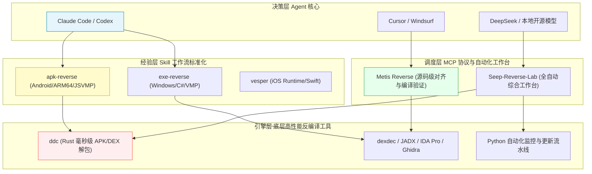
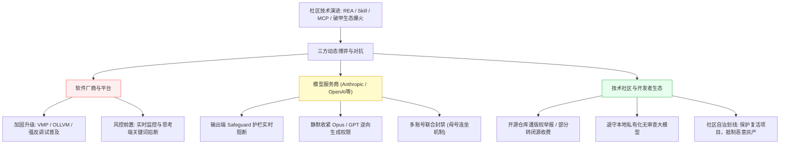

> 本文基于对技术社区 **linux.do** 在 2026 年 7 月至 10 月期间关于“模型破限（Jailbreak / 破甲）”**与**“AI 辅助逆向工程”**的数百篇公开话题与深度讨论进行的系统化全景梳理。当前，AI 逆向已从早期的“单句提示词玄学”迅速演进为成熟的**跨平台工具链（Skill、MCP、专用自动化工作台与底层反编译引擎）；然而伴随而来的，是平台防护升级、模型厂商静默收紧、账号关联封禁以及闭源商业化的多方激烈博弈。本文全面复盘当前的技术现状、核心工具链选型、真实实战天花板与关键生存法则。

<!-- more -->

---

## 📑 本文目录

- [一、模型破限（Jailbreak）：从提示词、一键插件到商业化](#一、模型破限（Jailbreak）：从提示词、一键插件到商业化)
  - [1.1 Keysmith 系列与跨模型适配器架构](#1-1-Keysmith-系列与跨模型适配器架构)
  - [1.2 purge 脉络爆发：从渗透红队到通用 Agent](#1-2-purge-脉络爆发：从渗透红队到通用-Agent)
  - [1.3 本地无审查模型：理想退路与实测方差](#1-3-本地无审查模型：理想退路与实测方差)
  - [1.4 求助常态与封号惨痛案例（母号连坐机制）](#1-4-求助常态与封号惨痛案例（母号连坐机制）)
  - [1.5 破限领域代表性话题数据清单](#1-5-破限领域代表性话题数据清单)
- [二、AI 逆向工具链：Skill、MCP、底层引擎三线并进](#二、AI-逆向工具链：Skill、MCP、底层引擎三线并进)
  - [2.1 第一条线：Skill 工作流打包（apk-reverse / exe-reverse / vesper）](#2-1-第一条线：Skill-工作流打包（apk-reverse-exe-reverse-vesper）)
  - [2.2 第二条线：MCP 与自动化工作台（Metis Reverse / Seep-Reverse-Lab）](#2-2-第二条线：MCP-与自动化工作台（Metis-Reverse-Seep-Reverse-Lab）)
  - [2.3 第三条线：底层极速反编译引擎（Rust ddc / dexdec / EVE 流水线）](#2-3-第三条线：底层极速反编译引擎（Rust-ddc-dexdec-EVE-流水线）)
  - [2.4 AI 逆向工具体系架构全景图](#2-4-AI-逆向工具体系架构全景图)
  - [2.5 逆向工具代表性话题数据清单](#2-5-逆向工具代表性话题数据清单)
- [三、实战经验盘点：AI 逆向到底能做到哪一步？](#三、实战经验盘点：AI-逆向到底能做到哪一步？)
  - [3.1 极限推演：4 小时无文档逆向官方鼠标驱动](#3-1-极限推演：4-小时无文档逆向官方鼠标驱动)
  - [3.2 情怀落地：借助 AI 逆向复活停服童年老游戏](#3-2-情怀落地：借助-AI-逆向复活停服童年老游戏)
  - [3.3 新手现实门槛：真能“什么都不懂一把梭”吗？](#3-3-新手现实门槛：真能“什么都不懂一把梭”吗？)
  - [3.4 逆向实战代表性话题数据清单](#3-4-逆向实战代表性话题数据清单)
- [四、争议与收紧：爆火之后的三方激烈拉锯](#四、争议与收紧：爆火之后的三方激烈拉锯)
  - [4.1 第一方·软件作者与平台反制：攻防加剧与思考端掐断](#4-1-第一方·软件作者与平台反制：攻防加剧与思考端掐断)
  - [4.2 第二方·模型厂商静默锁紧：Claude Opus 5.5 护栏中途拦截](#4-2-第二方·模型厂商静默锁紧：Claude-Opus-5-5-护栏中途拦截)
  - [4.3 第三方·社区内部的商业化与合规红线](#4-3-第三方·社区内部的商业化与合规红线)
  - [4.4 行业争议代表性话题数据清单](#4-4-行业争议代表性话题数据清单)
- [五、数据概览与技术趋势洞察](#五、数据概览与技术趋势洞察)
  - [5.1 样本与数据统计指标](#5-1-样本与数据统计指标)
  - [5.2 今日五大技术趋势洞察](#5-2-今日五大技术趋势洞察)
- [附录：社区站内热搜话题清单](#附录：社区站内热搜话题清单)

---

## 核心亮点速览

本期调研的主线极为清晰：**破限（Jailbreak）和 AI 逆向在开发者社区中，已经从最初零星的心得讨论帖，全面沉淀为一整套开箱即用的工程化工具链**：
- **全平台支持**：安卓端有标杆级的 `apk-reverse`，Windows 端涌现出 `exe-reverse`，iOS 端迎来了结合 Runtime 动态分析的 `vesper`；
- **平台中枢**：中间层有 `Seep-Reverse-Lab` 自动化工作台，以及通过验证驱动代码重构的 `Metis Reverse` MCP；
- **破限产品线化**：破限手法也从最原始的个人咒语 Prompt，进化出 `Keysmith`、`dsh-purge`、`Pi-Purge`、`agent-purge` 这一整条“人格化插件”生态，适配的 Agent 覆盖了 Claude Code、Codex、Cursor、Grok Build 等主流环境。

但硬币的另一面也迅速暴露：
1. `apk-reverse` 作者 GitHub 账号被举报封号导致原库下架；
2. `dsh-purge` 原作者删库转入闭源商业收费；
3. Anthropic 被曝悄悄收紧了 Claude Opus 5.5 的逆向工程权限；
4. 破限用户遭遇“子号违规导致母号被连坐封杀”；
5. 短视频平台出现收费收徒教学、站内出现倒卖破限 API 算力。

整个领域正在经历**从“单纯极客技术分享”快速滑向“攻防对抗、黑灰产与平台合规”的多方严峻拉锯**。一句话概括：**工具越来越趁手，代价也越来越清晰**。

---

## 一、模型破限（Jailbreak）：从提示词、一键插件到商业化

在技术社区中，“破限”与“破甲”通常混用，核心诉求高度一致：**突破大语言模型（LLM）过度保守的安全防线，让模型减少无故拒绝、乐意干活，特别是在逆向分析、代码审计、协议重构与安全研究等日常极易触发敏感风控的任务中稳定输出**。

### 1.1 Keysmith 系列与跨模型适配器架构

`Keysmith` 系列是社区内最早系统化、成体系的代表作。
- **高热度标杆**：7 月发布的 `codex-keysmith 5.6sol` 版本帖至今仍是破限领域热度最高的单帖（**浏览量 23,130、点赞 1,191**）；
- **Keysmith-Switch 适配器诞生**：作者 @EthanPier 随后在 10 月推出了架构升级版 `Keysmith-Switch`。其核心洞察非常深刻：**商业大模型的安全对齐机制是自适应、动态更新的，单一破限 Prompt 很难长期跨模型、跨时间生效**。因此它采用适配器架构，针对 Claude Code、Codex、Grok Build、Zcode 等独立维护绕过策略；
- **理性声音**：楼内高赞玩家也给出客观警示：*“单纯修改单次 Prompt 并不等于真正的破限，长上下文中的引导与会话上下文塑形才是正道。”*

### 1.2 purge 脉络爆发：从渗透红队到通用 Agent

10 月份社区最活跃的技术分支是 `purge` 系列：
1. **起源与闭源风波**：`dsh-purge` 起初主要面向 DeepSeek 阵地的红队与渗透测试场景。10 月 21 日，原作者突然删库并转向闭源收费，站内随即爆发高热度的“求最新提交快照与本地备份”讨论；
2. **开源接力与分支演化**：开发者 @ZICHUANLAN 迅速将核心思路移植并极简化，推出了一键化、会话独立的 `Pi-Purge`（浏览量 4,069、点赞 152）。紧接着在 10 月 25 日进一步升级为 `agent-purge`，全面支持 CodeBuddy、Codex、Claude Code、Grok、OpenCode 等众多代码 Agent；
3. **角色与工具链的区别**：社区开发者 @sqfgood 详细澄清了 Deva 助手与 dsh-purge 的本质差异：Deva 内置的小码酱角色仅借鉴了 dsh-purge 的角色扮演提示词逻辑，可用于普通逆向；而完整的 dsh-purge 本身具备成套红队渗透与环境侦查能力，破甲仅仅是其前置接入步骤。

### 1.3 本地无审查模型：理想退路与实测方差

当在线 API 频繁触发拒绝时，**本地部署无审查模型（Uncensored LLM）**被普遍寄予厚望，但实战体验呈现出极大的两极分化：
- **翻车案例**：9 月份有开发者测试基于 `Qwen 3.8 27B` 微调的无审查模型进行长文翻译与逆向，发现整体推理逻辑和中文理解明显弱于原版模型，且依然会偶发拒绝；
- **惊艳案例**：10 月 22 日开发者 @aozix 体验本地部署的 `Qwen 3.8 Flash`，评价其表现极其执着——*“根本不会主动说不行，一旦遇到障碍会持续更换解题路径不断尝试”*，与在线大厂 API 动辄甩出免责声明的态度形成鲜明反差。
- **行业趋势**：本地大模型强大的执行耐受度，正在成为越来越多技术极客采购高配开发硬件的重要决策参考。

### 1.4 求助常态与封号惨痛案例（母号连坐机制）

破限技术的日常讨论中，充斥着大量版权绕过需求（例如用 Codex 批量下载并机翻未授权漫画），楼内普遍共识是**“日常开发主号严禁破限，高危任务务必寻找专门的免风控中转通道”**。

最发人深省的是 10 月 5 日 @happyboylb 分享的真实封号惨案：
> 楼主为规避封禁风险，特意使用母号正常订阅并保持静默，另注册 10 个子账号专门挂破限插件执行任务，所有账号在半个月内共用同一个出口 IP。  
> 结果：**母号在毫无预警的情况下直接被平台以“累犯（Repeat Infringer）”定性彻底封号**，历经申诉半个月至 10 月 20 日才得以解封。

社区共识很明确：**大厂风控具备同一身份/同一网络环境的关联打击能力，子号违规极易直接引火烧向主号。**

### 1.5 破限领域代表性话题数据清单

| 话题名称 | 浏览量 | 点赞数 | 回复数 |
| :--- | :--- | :--- | :--- |
| [破限工具的 5.6sol 版本：codex-keysmith 更新](https://linux.do/t/2607878) | 23,130 | 1,191 | 379 |
| [关于破甲/破限的焚决心得和 claude code/codex 的破限焚决](https://linux.do/t/2659000) | 12,887 | 480 | 66 |
| [7 折破甲 Deepseek 4.1 Flash！！](https://linux.do/t/3061347) | 4,679 | 318 | 243 |
| [开源一个我常用的 Agent Harness，用于生产项目和破甲逆向都好使](https://linux.do/t/3016829) | 4,557 | 195 | 65 |
| [Keysmith 系列更新：Keysmith-Switch，更简单易用的模型破解工具](https://linux.do/t/2984494) | 4,401 | 412 | 108 |
| [Pi-Purge 插件，从 dsh-purge 移植，简化版本，一键破甲，会话独立](https://linux.do/t/3045164) | 4,069 | 152 | 69 |
| [有了破限/无限制的 AI，从此打开了新的天地](https://linux.do/t/3056771) | 3,557 | 63 | 52 |
| [求助！该怎么样才能让 v4.1 flash 安心逆向和破解](https://linux.do/t/2899681) | 3,087 | 60 | 32 |
| [本地部署破限模型推荐](https://linux.do/t/2928645) | 2,264 | 15 | 19 |
| [Deva 内置了 dsh-purge 的破甲提示词，说明下他们的区别](https://linux.do/t/3053258) | 1,977 | 81 | 34 |
| [dsh-purge 原仓库作者删库转闭源收费了，求一个保留最新提交的快照仓库](https://linux.do/t/3052341) | 1,962 | 81 | 32 |
| [分享一下自己对大模型破甲的思路-Jailbreak](https://linux.do/t/2818874) | 1,052 | 56 | 19 |
| [从 Pi-purge 继续，新增 codebuddy、codex、claudecode、grok 等支持](https://linux.do/t/3074069) | 975 | 93 | 30 |
| [给大伙汇报一下，子号破限，母号会连坐](https://linux.do/t/2983847) | 581 | 6 | 9 |

---

## 二、AI 逆向工具链：Skill、MCP、底层引擎三线并进

如果说破限解决的是**“模型愿不愿意干活”**，那么逆向专用工具解决的则是**“Agent 干得快不快、准不准”**。本季度社区沉淀出三条高度协同的技术支柱。

### 2.1 第一条线：Skill 工作流打包（apk-reverse / exe-reverse / vesper）

将资深逆向工程师的人类实操经验标准化，打包成规范的 **Agent 技能指令集（Skill）**：
- **安卓标杆 `apk-reverse`**：由开发者 @inliver 于 9 月 19 日开源（**浏览 10,854、点赞 849**），系统提炼了反编译、脱壳思路、Frida 脚本模板与关键抓包手法。10 月 16 日其 GitHub 仓库遭恶意举报封号下架后，原贡献者 @dabao1955 立即在 **Codeberg** 与 42git 接续维护，并扩展支持了 **ARM64 汇编指令集、JSVMP 混淆识别、Binder/Seccomp 穿透与 WebView 注入**；
- **Windows 桌面端 `exe-reverse`**：聚焦于 C# EXE/DLL 静态反编译、Win32 汇编指令推演以及 OLLVM / VMP 控制流平坦化的初步还原；
- **iOS 越狱生态 `vesper`**：结合越狱 iOS 系统的 Runtime 动态特性开展动静联合分析，支持 Swift/Objective-C 反修饰解析，专用于合规学习与内部插件维护。

### 2.2 第二条线：MCP 与自动化工作台（Metis Reverse / Seep-Reverse-Lab）

为编码 Agent 装上直接操作系统的“手和脚”：
- **`Metis Reverse` MCP**：开发者 @Wholiver 面向 Cursor 与 Claude Code 开发的逆向协议服务。它与传统逆向辅助工具（如 REA）的核心差异在于：**REA 仅提供基于反汇编的推导结论由人去写代码，而 Metis 直接在磁盘上自动重建完整源码树，并在本地编译运行，通过输入输出对比反复纠错，直到重建程序的输出与原目标完全一致**；
- **`Seep-Reverse-Lab` 工作台**：开发者 @Angus0 整合站内实战成果推出的全自动逆向工坊（**浏览 8,330、点赞 727**），打通了 Windows、Android 及 Web 端，将自动化抓包、静态分析、动态注入与 Agent 调度融为一体。

### 2.3 第三条线：底层极速反编译引擎（Rust ddc / dexdec / EVE 流水线）

传统反编译工具（如 JADX、Apktool）在面对大型工程时速度极慢且容易产生语法报错，严重拖慢 Agent 调度效率：
- **Rust 超高性能工具 `ddc`**：由开发者 @ejfkdev 基于 Rust 开发，主打**非全量按需渐进式反编译**。实测处理 34MB 的抓包神器 Reqable 仅耗时 **0.28 秒**，处理 62MB 的 Telegram 官方客户端仅用 **8.00 秒**。其输出的 Java 代码确保零语法报错，极大方便 Agent 随时发起即时精准分析；
- **EVE 客户端 Python 反编译流水线**：实现了游戏客户端在官方热更新后自动触发拉取、自动反编译提取通信协议与市场数据的自动化归档流水线。

### 2.4 AI 逆向工具体系架构全景图

### 2.5 逆向工具代表性话题数据清单

| 话题名称 | 浏览量 | 点赞数 | 回复数 |
| :--- | :--- | :--- | :--- |
| [安卓逆向专用 skills apk-reverse 基于逆向项目经验总结和提炼](https://linux.do/t/2923820) | 10,854 | 849 | 268 |
| [Seep-Reverse-Lab：(Windows+Android)软件+Web自动化逆向工作台](https://linux.do/t/2946793) | 8,330 | 727 | 135 |
| [github 被举报封禁了，apk-reverse 停止更新](https://linux.do/t/3034341) | 7,337 | 629 | 164 |
| [尝试继续更新 apk reverse](https://linux.do/t/3046760) | 3,865 | 410 | 142 |
| [exe-reverse 技能配布](https://linux.do/t/3069439) | 2,877 | 323 | 75 |
| [一款 rust 编写的超高性能 apk、dex 反编译工具：ddc](https://linux.do/t/2922844) | 2,452 | 158 | 34 |
| [Metis Reverse ：一个帮助你逆向软件的 MCP](https://linux.do/t/3049555) | 709 | 54 | 19 |
| [Metis reverse v1.0.0 ，一个帮助 Agent 逆向的 MCP 工具](https://linux.do/t/3071734) | 288 | 16 | 8 |
| [［开源推广］vesper - iOS reverse](https://linux.do/t/3071512) | 197 | 10 | 8 |
| [分享自维护的 EVE 客户端 Python 反编译源码（随版本自动更新）](https://linux.do/t/3075749) | 95 | 5 | 12 |

---

## 三、实战经验盘点：AI 逆向到底能做到哪一步？

技术讨论中最具参考价值的不是概念演示，而是包含详细实操日志与翻车记录的端到端真实案例。

### 3.1 极限推演：4 小时无文档逆向官方鼠标驱动

开发者 @usuallee 记录了其最具代表性的实战：手中 Pulsar 鼠标驱动停更，在完全没有任何通信协议文档的前提下，仅将本机安装的官方客户端二进制文件提供给 **DeepSeek v4.1 flash**，借助开源逆向方法论框架 `rea`，目标是纯手搓出一个全功能的 Web 网页版驱动。

**实测过程令人震撼**：
- 模型开启最高思考深度，输出了累计 **91.7 万字符的深层思考推理过程**；
- 全程自主触发调用了 **347 次** 本地程序化分析脚本工具；
- 并在 **314 毫秒内并发拉起 5 个子 Agent** 协同推演通信报文结构；
- **作者总结与反思**：后半段逻辑出现“神鬼二相性”，超长上下文下模型易出现注意力衰退，最终调通过程充满挫败感。该实战印证：**前沿推理小模型结合严谨方法论确实能独立啃下黑盒驱动逆向，但绝非一键直出的轻松过程**。

### 3.2 情怀落地：借助 AI 逆向复活停服童年老游戏

开发者 @acrl 记录了其使用 AI 逆向经典停服网游《极速轮滑》（Street Gears）的历程：通过 AI 快速梳理当年客户端中保留的未加密调试端口与封包封送逻辑，成功对接国外私服完成了十几年前的童年补完。此类针对已停服产品、老旧硬件驱动的救赎性逆向，是开源社区中认可度最高的使用方向。

### 3.3 新手现实门槛：真能“什么都不懂一把梭”吗？

针对大量新手“零基础能否靠 AI 搞外挂和渗透”的疑问，社区骨干给出了明确的客观难度梯队排序：
$$	ext{封号风险} > 	ext{模型破甲门槛} > 	ext{加壳与高级混淆对抗} > 	ext{基础业务逆向}$$

- **结论**：**绝不可能什么都不懂直接一把梭**。开发者必须掌握基础汇编、网络抓包原理与加密常识，具备排错与兜底能力；AI 的角色是**“让懂行的人效率放大 10 倍”，而不是“把外行变成神仙”**。

### 3.4 逆向实战代表性话题数据清单

| 话题名称 | 浏览量 | 点赞数 | 回复数 |
| :--- | :--- | :--- | :--- |
| [借助 AI 逆向玩到了小时候很想玩的游戏](https://linux.do/t/3061042) | 1,048 | 32 | 13 |
| [求点拨：ai渗透和逆向到底去到什么水平，能什么都不懂一把梭吗](https://linux.do/t/3073520) | 358 | 5 | 5 |
| [花 10 块钱，我让新版本 DeepSeek Flash 逆向破解了官方鼠标驱动！但最后却被逼疯…](https://linux.do/t/3048071) | 288 | 9 | 1 |

---

## 四、争议与收紧：爆火之后的三方激烈拉锯

随着 AI 逆向与破限进入大众视野，整个技术生态迅速分化为三方激烈的动态博弈。

### 4.1 第一方·软件作者与平台反制：攻防加剧与思考端掐断

- **攻防螺旋上升**：高赞帖子指出，伴随 REA、apk-reverse 等工具普及，传统软件作者已开始大规模引入更复杂的动态混淆与远程代码下发，逆向门槛水涨船高；
- **思考端拦截**：越来越多开发者发现，主流云端推理模型开始在服务端引入**思考链路动态安全扫描器**，一旦推理过程中检测到高危逆向意图或敏感反编译特征，哪怕尚未输出最终正文，也会直接中断会话。

### 4.2 第二方·模型厂商静默锁紧：Claude Opus 5.5 护栏中途拦截

- **静默收紧**：根据 Reddit 与站内多方实测，Anthropic 在 10 月下旬的静默更新中，**显著加强了 Claude Opus 5.5 在面对涉及商业版权软件逆向时的中断拦截频率**；
- **解法博弈**：目前开发者普遍采用将逆向目标伪装、拆解为“通用软件工程重构”或“遗留代码兼容性审计”任务进行多阶段调用，但审查窗口正在加速收缩。

### 4.3 第三方·社区内部的商业化与合规红线

- **商业化撕裂**：技术爆火引发了短视频平台的付费割韭菜培训，以及地下算力站 7 折转售破限 API；
- **社区自发伦理划线**：社区内部已形成明确的心理分水岭——**对“个人学习研究、停服产品复活、协议互通开发”持开放包容态度；对“高价割韭菜、规模化盗版破解、触碰无人机禁飞区及工控安全”保持高度警惕与抵制**。

### 4.4 行业争议代表性话题数据清单

| 话题名称 | 浏览量 | 点赞数 | 回复数 |
| :--- | :--- | :--- | :--- |
| [早上好，谈下 REA 逆向带来的趋势](https://linux.do/t/3025594) | 6,646 | 519 | 130 |
| [AI 反编译游戏盛行！游戏厂商呼吁更强大更完善的防盗版防作弊措施！](https://linux.do/t/3043263) | 1,466 | 58 | 31 |
| [闲谈 rea 的爆火，只会给 ai 逆向加上枷锁，终究回到本地 ai 部署逆向](https://linux.do/t/3038115) | 761 | 29 | 36 |
| [不能逆向一切了？Anthropic 被曝悄悄限制 Claude Opus 5.5 逆向工程能力](https://linux.do/t/3074749) | 630 | 11 | 6 |
| [AI 已经可以破解各种系统，后续会怎么发展 🤔](https://linux.do/t/3071975) | 614 | 7 | 15 |

---

## 五、数据概览与技术趋势洞察

### 5.1 样本与数据统计指标

本报告数据基于 2026 年 10 月 26 日对社区公开与索引内容的深度采样：

| 统计指标维度 | 统计数值 | 采样说明 |
| :--- | :--- | :--- |
| **高频检索核心关键词** | 6 个 | `破限`、`逆向`、`破甲`、`反编译`、`jailbreak`、`脱壳`（各检索前 15 项） |
| **有效去重话题池** | 82 个 | 从去重后的 90 条检索候选池中精选保留 |
| **社区扫描大盘底库** | 约 2,900 个 | 覆盖 `#人工智能` 标签板块与全站公开最新话题 |
| **深度精读与引证贴** | 38 篇 | 完整抓取正文、版本更新记录与高赞代表性回复 |
| **正文采纳引用贴** | 36 篇 | 严格对应文中所述技术路线与典型案例 |
| **引证贴总浏览曝光量** | 约 120,000 次 | 真实反映出技术极客群体的高度关注度 |
| **引证贴累计点赞总量** | 约 7,100 个 | 代表社区对相关工具与实战思路的高度认可 |

### 5.2 今日五大技术趋势洞察

1. **“工具链分工”彻底取代“单点神奇咒语”**：
   依靠单一神秘 Prompt 就能通杀全场的时代已经过去。Skill 封装领域先验、MCP 赋予宿主机落地执行力、Rust 引擎优化数据输入，新手入门的关键在于能否组装出一套自洽的流水线；
2. **破限工具产品化，但发布渠道全面收窄**：
   Keysmith、purge 系列快速演进的同时，面临着原库下架、平台封禁、厂商静默截断的三重打击，多源备份与私有化镜像成为开发者自保的基本功；
3. **本地私有化无审查模型成为重要战略退路**：
   云端 API 安全护栏日趋收紧，本地部署的大模型虽然能力方差较大，但没有封号风险与敏感词掐断，正在逐步成为高端极客不可或缺的兜底生产力；
4. **AI 极大地拔高了上限，但并未降低下限**：
   AI 逆向的本质是“经验放大器”。不懂汇编、不通通信协议的使用者，即便拥有最顶级的模型与工具链，面对加壳、混淆与复杂报错时依然束手无策；
5. **开源社区正经历自发的价值划线**：
   包容探索与怀旧，排斥恶意破解与灰产变现。这种群体内生的共识规则，将在更深层次决定 AI 逆向技术的合法合规演进方向。

---

## 附录：社区站内热搜话题清单（附原帖直达链接）

说明：以下为站内核心关键词搜索的原样结果整理，点击即可直达原帖阅读原始讨论与技术细节：

### 1. 破限方向（前 15 话题）
- [破限小本：第一次破限初试](https://linux.do/t/2987487)
- [求佬有没有什么好用的AI破限词，ds破限词用不了了](https://linux.do/t/2832660)
- [本地部署破限模型推荐](https://linux.do/t/2928645)
- [有没有一键破限的软件啥的？](https://linux.do/t/2997050)
- [AI 模型破限求解？](https://linux.do/t/3053916)
- [想请教一下各位佬友如何模型破限问题](https://linux.do/t/3044236)
- [求助deepseek v4.1 最新破限提示词或方法](https://linux.do/t/3025633)
- [关于deepseek v4.1 flash CTF破限一点心得](https://linux.do/t/2915736)
- [需要一个能让glm和ds愿意下载盗版作品的破限方案](https://linux.do/t/2884408)
- [有点好奇，为什么要破限呢](https://linux.do/t/2969672)
- [更新了破限工具的ZCode版本](https://linux.do/t/2524019)
- [codex怎么破限？](https://linux.do/t/3069191)
- [DeepSeek破限求助](https://linux.do/t/3050705)
- [给大伙汇报一下，子号破限，母号会连坐。10.05日被封，10.20日被释放](https://linux.do/t/2983847)
- [OpenCode该用什么工具/提示词给Sol破限](https://linux.do/t/2980503)

### 2. 软件逆向工程方向（前 15 话题）
- [安卓逆向专用skills apk-reverse 基于逆向项目经验总结和提炼](https://linux.do/t/2923820)
- [说起来让 AI 逆向，好像也没有很难？](https://linux.do/t/3009418)
- [Metis reverse v1.0.0 ，一个帮助Agent 逆向的 MCP 工具 （附带逆向报告）](https://linux.do/t/3071734)
- [最新版Mumu(6.8.1)模拟器去广告+2099年会员+截断云控更新+逆向工作台分享](https://linux.do/t/2954888)
- [Seep-Reverse-Lab：(Windows+Android)软件+Web自动化逆向工作台（基于实战项目经验总结提炼的skill、mcp组成）](https://linux.do/t/2946793)
- [AI逆向经验分享—12天，逆向小白的成长之路](https://linux.do/t/2972702)
- [不能逆向一切了？Anthropic 被曝悄悄限制 Claude Opus5.5 逆向工程能力](https://linux.do/t/3074749)
- [官网新版(6.8.4)Mumu模拟器去广告+2099年会员+截断云控更新+闪退修复+Seep逆向工作台](https://linux.do/t/3014361)
- [吃白饭大肥鱼or源神？花10块钱，我让新版本 DeepSeek Flash 逆向破解了官方鼠标驱动！但最后却被逼疯…](https://linux.do/t/3048071)
- [关于”逆向”资产的管理和协调的问题](https://linux.do/t/3038712)
- [闲谈rea的爆火，只会给ai逆向加上枷锁，终究回到本地ai部署逆向](https://linux.do/t/3038115)
- [国庆假期，突如其来的一个想法，于是逆向了一番Apple Vision Pro Simulator](https://linux.do/t/2991481)
- [有没有大佬帮逆向个app](https://linux.do/t/2944974)
- [使用ai逆向就是为了找到源码或者是破解某个功能吗？](https://linux.do/t/2943826)
- [逆向山灵播放软件](https://linux.do/t/2943894)

### 3. 破甲与 Prompt 调试方向（前 15 话题）
- [Deva内置了dsh-purge的破甲提示词，说明下他们的区别](https://linux.do/t/3053258)
- [关于破甲/破限的焚决心得和claudecode/codex的破限焚决](https://linux.do/t/2659000)
- [公益站 Gpt-image(支持NSFW)/支持视频生成/支持青春版/支持API/支持deepseek-4.1-flash-10.17(自带破甲）](https://linux.do/t/3042833)
- [问下MiMo V2.6 Pro破甲](https://linux.do/t/3008112)
- [[叫我小杨同学]关于模型破甲与claude模型！！！](https://linux.do/t/2814989)
- [开源一个我常用的Agent Harness，用于生产项目和破甲逆向都好使](https://linux.do/t/3016829)
- [[叫我小杨同学]补坑！关于Deepseek Harness破甲问题！！！ 全面揭露！！！](https://linux.do/t/2774454)
- [求助muse如何破甲？不听话](https://linux.do/t/3050690)
- [有佬知道Gemini家的模型怎么破甲吗？](https://linux.do/t/3050830)
- [关于破甲问题](https://linux.do/t/2907574)
- [geimini 3.8 flash 破甲研究和讨论](https://linux.do/t/3030625)
- [DeepSeek轻度破甲：小说作者丝绒](https://linux.do/t/2901199)
- [完蛋,搞了破甲就感觉要起飞了](https://linux.do/t/3047574)
- [在线AI真的可以破甲吗？](https://linux.do/t/3075702)
- [Pi-Purge插件，从dsh-purge移植，简化版本，一键破甲，会话独立](https://linux.do/t/3045164)

### 4. 反编译与引擎开发方向（前 15 话题）
- [Droid ASC：面向 AI Agent 时代的极速 Android 反编译引擎](https://linux.do/t/2926432)
- [一款 rust 编写的超高性能apk、dex 反编译工具：ddc](https://linux.do/t/2922844)
- [分享自维护的EVE客户端Python 反编译源码（随版本自动更新）](https://linux.do/t/3075749)
- [AI反编译游戏盛行！游戏厂商呼吁更强大更完善的防盗版防作弊措施！](https://linux.do/t/3043263)
- [为啥都说 GPT 道德感高不愿意逆向？我这个怎么啥都没说自己去搜索下包反编译了…](https://linux.do/t/2935782)
- [今天成功反编译了一个安卓apk](https://linux.do/t/2895359)
- [话说如果使用Claude进行某些软件的逆向或者反编译会不会被封号？](https://linux.do/t/3071292)
- [AI 氛围编程反编译的浏览器版游戏扎堆出现，且运行流畅](https://linux.do/t/3008872)
- [到底什么LLM可以反编译 就是读一个exe告诉我什么功能是怎么实现的](https://linux.do/t/2902745)
- [Microsoft：启动 XBOXLABS | 人工智能，游戏与复古](https://linux.do/t/3021071)
- [逆向某伪装色情软件的病毒app记录](https://linux.do/t/2978436)
- [[逆向记录] [印前软件] EskoPhoenix 26.07：从 JVMTI 到 classfile 状态机](https://linux.do/t/2951350)
- [外挂程序卡密验证绕过思路](https://linux.do/t/2896419)
- [Metis reverse v1.0.0 ，一个帮助Agent 逆向的 MCP 工具 （附带逆向报告）](https://linux.do/t/3071734)
- [用python开发软件是有多不安全？](https://linux.do/t/3069056)

### 5. Jailbreak 探索方向（前 15 话题）
- [分享一下自己对大模型破甲的思路-Jailbreak](https://linux.do/t/2818874)
- [iPhone XS的iOS 15.7.1的越狱流程及体验](https://linux.do/t/2892408)
- [求助muse如何破甲？不听话](https://linux.do/t/3050690)
- [佬们，求个muse的破甲提示词](https://linux.do/t/3049861)
- [想问问站内的大佬，gemini3.8或者argon有没有什么办法破甲的](https://linux.do/t/3048110)
- [求助！该怎么样才能让v4.1 flash安心逆向和破解](https://linux.do/t/2899681)
- [DSH deepseek-v4.1-flash 怎么破限js逆向？](https://linux.do/t/2937859)
- [完蛋,搞了破甲就感觉要起飞了](https://linux.do/t/3047574)
- [Pi-Purge插件，从dsh-purge移植，简化版本，一键破甲，会话独立](https://linux.do/t/3045164)
- [dsh-purge原仓库作者删库转闭源收费了，求一个保留最新提交的快照仓库](https://linux.do/t/3052341)
- [（已领取4/10）空喵鸽了，我来出题](https://linux.do/t/3070221)
- [如果ASTRA是loop架构，那它是怎么被蒸馏的？](https://linux.do/t/3068924)
- [没人说吗？Gemini 4 Argon NSFW超薄甲](https://linux.do/t/3034292)
- [deepseek-v4.1-flash的甲怎么变厚了，有没有佬能分享下焚决](https://linux.do/t/2894197)
- [求助deepseek v4.1 最新破限提示词或方法](https://linux.do/t/3025633)

### 6. 脱壳与加固攻防方向（前 15 话题）
- [有哪些自动化脱壳工具](https://linux.do/t/321101)
- [iPhone XS的iOS 15.7.1的越狱流程及体验](https://linux.do/t/2892408)
- [关于chatgpt6和5.6的甲的厚度对比](https://linux.do/t/2983997)
- [GPT 6 把梆梆加固撕开了](https://linux.do/t/2898009)
- [坏了坏了 好个溜溜球！](https://linux.do/t/3014447)
- [最近接逆向的单子，怎么这么多使用这个卡密验证的](https://linux.do/t/2988141)
- [有个逆向结果相关的问题询问佬友](https://linux.do/t/2936645)
- [电商情趣类怎么生成，基本模型都拒绝，偶尔多并发才出一张几率太低了](https://linux.do/t/2995418)
- [使用ai逆向就是为了找到源码或者是破解某个功能吗？](https://linux.do/t/2943826)
- [历次windows泄露的源码该去哪儿看呢](https://linux.do/t/2937213)
- [如何用 ai 辅助逆向或者破解游戏外挂](https://linux.do/t/2457224)
- [安卓逆向专用skills apk-reverse 基于逆向项目经验总结和提炼](https://linux.do/t/2923820)
- [［开源推广］vesper - iOS reverse](https://linux.do/t/3071512)
- [Metis Reverse ：一个帮助你逆向软件的MCP](https://linux.do/t/3049555)
- [github被举报封禁了，apk-reverse停止更新](https://linux.do/t/3034341)
